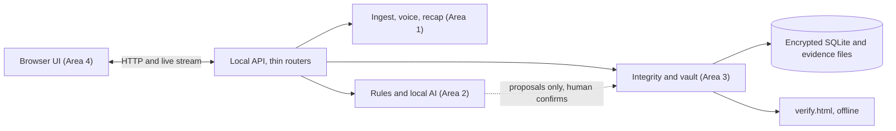
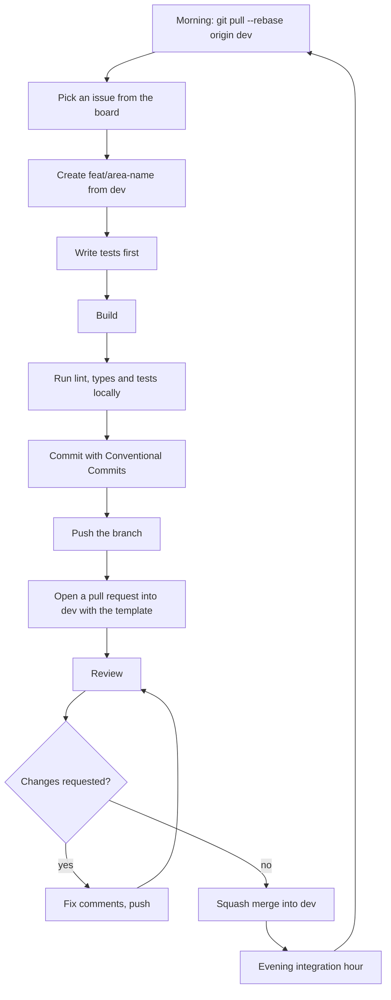
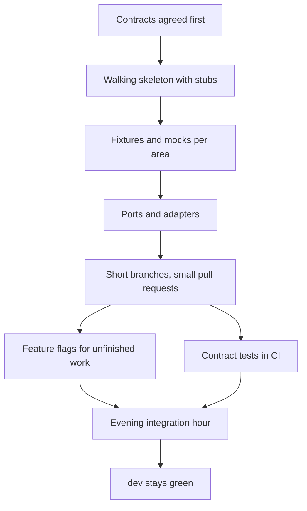
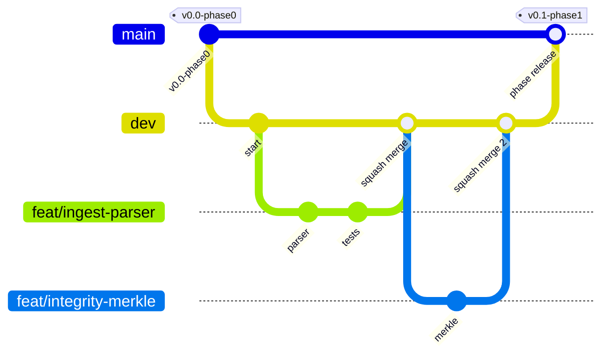
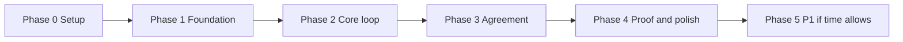

# VeriDoc Team Handbook

How we work: onboarding, setup, methodology, Git, phases and releases.

## Contents

- [Onboarding](#onboarding)
- [Team Guide](#team-guide)
- [Developer Setup](#developer-setup)
- [Development Methodology](#development-methodology)
- [Git Workflow](#git-workflow)
- [Phases](#phases)
- [Release Checklist](#release-checklist)

---

## Onboarding

This file takes a developer who has never seen VeriDoc from zero to a first merged pull request. It is written for a beginner: numbered steps, exact commands for Windows, macOS and Linux, and a short reason for each rule. Follow the sections in order. Active members: Hardik (Areas 1, 3 and 4) and Abhishek (Area 2). Samanway and Jhashank are no longer active; see the README (Contributors).

Last updated: 2026-10-25
Status: Draft v1

Conventions: commands in a code block are typed into a terminal. On Windows use PowerShell (or Git Bash where it says so). On macOS use Terminal. On Linux use your terminal. Where a command differs by system, you see three labelled blocks. Commands that need code that does not exist yet are marked `TBD`; the team confirms them in [SETUP](#developer-setup) when the code lands.

### 1. Welcome

VeriDoc in five lines:
1. It reads a WhatsApp deal chat (and voice notes) on the user's own laptop.
2. It finds the key terms, links each one to its source message, and flags what is ambiguous, missing or contradictory.
3. It suggests one friendly next message, builds a plain-language recap, and the other side confirms with a short code in WhatsApp.
4. It keeps a tamper-evident record that anyone can check on an offline page.
5. It is a drafting and record-keeping aid, not legal advice.

**The problem (LS-06, From Handshake to Contract).** Small suppliers, freelancers and tutors close deals on WhatsApp. Price is in one message, the changed deadline is in a voice note, the payment term was never said. Asking for a contract feels legalistic, so people avoid it. When someone refuses to pay or deliver, the missing terms cannot be recovered.

**The flow: Handshake, Recap, Receipt.**
- Handshake: the two sides chat as usual, and VeriDoc watches for gaps.
- Recap: a short friendly summary goes to the other side, who replies `CONFIRM <code>`.
- Receipt: every message, voice note and agreement version is hashed and chained. Anyone can verify it offline.

**Example.** Raju (cloth wholesaler) and Meena (tailor) agree on 200 shirts at ₹480 each. Raju says "advance half now" and Meena sends ₹48,000. Meena says "delivery next week". Nobody says when the balance is due or what happens if delivery is late. VeriDoc marks delivery as Ambiguous, final payment and late penalty as Missing, and suggests: "Just to confirm, delivery by 15 Nov and the balance ₹48,000 on delivery, right?" (the date is an example). After Raju sends it and the answer arrives, the recap goes out, Meena replies `CONFIRM 7F3K`, and the receipt can be verified by anyone.

### 2. Read these first

Read them in this order. Plan about two hours. You do not need to memorise them; you need to know where things are.

| Document | Why it matters |
|---|---|
| [PRD](PRODUCT.md#veridoc-product-requirements-document-prd) | What we build and the acceptance criteria. Every pull request links to its requirement IDs (for example `FR-IMP-001`). |
| [ARCHITECTURE](TECHNICAL.md#architecture) | The parts of the system, the folder tree, and who owns each folder. |
| [DECISIONS](TECHNICAL.md#architecture-decision-records) | Why we chose each technology. Read before proposing a change of tool. |
| [INTEGRITY_SPEC](TECHNICAL.md#integrity-specification) | Exact hashing rules. A mistake here breaks the evidence. Everyone should skim it. |
| [AI_SPEC](TECHNICAL.md#ai-specification) | How terms are extracted and why the AI can never write to the record. |
| [PHASES](#phases) | What to work on now and what each phase must achieve. |
| [TEAM_GUIDE](#team-guide), [GIT_WORKFLOW](#git-workflow), [DEVELOPMENT_METHODOLOGY](#development-methodology) | How we work together. |
| [LIMITS](PRODUCT.md#honest-limits) | The wording we must use on screen and in code comments. |
| [GLOSSARY](PRODUCT.md#glossary) | Unknown word? Look here. |

### 3. Team and areas

The repository is split into four ownership areas so each person mostly edits their own folders. Active members: Hardik (Areas 1, 3 and 4) and Abhishek (Area 2). Samanway and Jhashank are no longer active; see the README (Contributors).

| Area | Owns | Role | Member |
|---|---|---|---|
| 1. Ingest, Agreement and Release | `packages/ingest`, `apps/api/routers/ingest.py`, `apps/api/routers/agreement.py`, `playbooks/templates/`, `packaging/`, sample chats and demo voice notes | Ingest, agreement and release lead | Hardik (@HARDIKSINGH150206) |
| 2. AI and ML | `packages/intelligence`, `playbooks/` (except `playbooks/templates/`), `eval/`, `apps/api/routers/analysis.py` | AI and ML lead | Abhishek (@absksync) |
| 3. Backend, Integrity and Vault | `apps/api/main.py`, `packages/contracts` (steward: Hardik; changes need Hardik and Abhishek), `packages/integrity` (except `packages/integrity/anchoring/`), `packages/vault`, `test-vectors/`, `apps/api/routers/vault.py`, `apps/api/routers/export.py`, `.github/workflows/`, `pyproject.toml`, `uv.lock` | Backend and integrity lead | Hardik (@HARDIKSINGH150206) |
| 4. Frontend and Blockchain | `apps/web`, `apps/verify`, `packages/integrity/anchoring/` | Frontend and blockchain lead; project release lead | Hardik (@HARDIKSINGH150206) |

Shared, changed only by small reviewed pull requests: `packages/contracts` (steward: Hardik; every change needs approval from Hardik and Abhishek), `docs/`, `.github/` (except `.github/workflows/`, Area 3).

**Hotspots and who owns them (and why: one owner per hotspot means no two people edit the same file at once):**

| Hotspot | Owner | What you do instead of editing it |
|---|---|---|
| Contracts (`packages/contracts`) | Hardik (steward) and Abhishek approve, by pull request | Open a small contracts pull request, see section 16 |
| Dependency files (`pyproject.toml`, `uv.lock`) | Area 3 (Hardik) | Open an issue asking for the dependency |
| Design tokens (`apps/web/assets/design-tokens.css`) | Area 4 (Hardik) | Ask in an issue |
| Migrations (`packages/vault/migrations/`) | Area 3 (Hardik) | Open an issue describing the schema change you need |
| `apps/api/main.py` | Area 3 (Hardik) | You never need to edit it: routers load automatically (ADR-022) |
| Release (merge `dev` into `main`, tags, changelog) | Hardik | Ask in the team chat |
| Hardware tier thresholds and model choice | Abhishek | Open an issue |

### 4. Access checklist

Ask Hardik (repo owner) if anything is missing.

- [ ] A GitHub account, with your name or a recognisable username
- [ ] Two-factor authentication turned on in GitHub (Settings, Password and authentication). Reason: the repo holds the evidence layer.
- [ ] An invitation to `HARDIKSINGH150206/Veridoc` accepted (check your email or github.com/notifications)
- [ ] Added to the team chat (platform TBD)
- [ ] Open the project board and find your area's cards: [VeriDoc board](https://github.com/users/HARDIKSINGH150206/projects/1) (public: anyone can view it; only collaborators can move cards)
- [ ] Your GitHub handle is in `.github/CODEOWNERS` (current handles: `@HARDIKSINGH150206` Hardik for Areas 1, 3 and 4, `@absksync` Abhishek for Area 2)

### 5. Install tools

You need: Git, GitHub CLI (`gh`), Python 3.11 or later, uv, VS Code, and optionally Claude Code or Codex. Node.js LTS is needed later for the JavaScript test vectors.

#### Windows (PowerShell)

```
winget install --id Git.Git -e
winget install --id GitHub.cli -e
winget install --id Python.Python.3.11 -e
winget install --id Microsoft.VisualStudioCode -e
winget install --id OpenJS.NodeJS.LTS -e
powershell -ExecutionPolicy ByPass -c "irm https://astral.sh/uv/install.ps1 | iex"
```
Close and reopen PowerShell after installing. If `python` opens the Microsoft Store, turn off the "App execution aliases" for Python in Windows Settings, or use `py -3.11` instead. Check versions:
```
git --version
gh --version
python --version
uv --version
code --version
node --version
```

#### macOS (Terminal, with Homebrew)

If you do not have Homebrew, install it from https://brew.sh first.
```
brew install git gh python@3.11 node
brew install --cask visual-studio-code
curl -LsSf https://astral.sh/uv/install.sh | sh
```
Check versions:
```
git --version
gh --version
python3 --version
uv --version
code --version
node --version
```
On Apple Silicon use the native arm64 tools (Homebrew does this by default). If `code` is not found, open VS Code, press Cmd+Shift+P and run "Shell Command: Install 'code' command in PATH".

#### Linux (Ubuntu or Debian)

```
sudo apt update
sudo apt install -y git python3.11 python3.11-venv nodejs npm curl
curl -LsSf https://astral.sh/uv/install.sh | sh
```
If `python3.11` is not available on your release, use `uv python install 3.11` (uv downloads Python for you).

Install GitHub CLI from its official apt repository:
```
sudo mkdir -p -m 755 /etc/apt/keyrings
wget -qO- https://cli.github.com/packages/githubcli-archive-keyring.gpg | sudo tee /etc/apt/keyrings/githubcli-archive-keyring.gpg > /dev/null
sudo chmod go+r /etc/apt/keyrings/githubcli-archive-keyring.gpg
echo "deb [arch=$(dpkg --print-architecture) signed-by=/etc/apt/keyrings/githubcli-archive-keyring.gpg] https://cli.github.com/packages stable main" | sudo tee /etc/apt/sources.list.d/github-cli.list > /dev/null
sudo apt update
sudo apt install -y gh
```
Other distributions: https://github.com/cli/cli/blob/trunk/docs/install_linux.md.

Install VS Code:
```
sudo snap install --classic code
```
Other ways: https://code.visualstudio.com/docs/setup/linux. Restart the terminal, then check versions:
```
git --version
gh --version
python3 --version
uv --version
code --version
node --version
```

Expected: Git 2.30 or later, Python 3.11 or later. Why Python 3.11+: the project uses its typing features, and `pyproject.toml` will require it.

#### VS Code extensions (recommended)

Install from the Extensions panel or with `code --install-extension <id>`:

| Extension | Id | Why |
|---|---|---|
| Python | `ms-python.python` | Run and debug |
| Ruff | `charliermarsh.ruff` | Same linter and formatter as pre-commit |
| Mypy Type Checker | `ms-python.mypy-type-checker` | Type errors as you type |
| EditorConfig | `editorconfig.editorconfig` | Respect `.editorconfig` |
| GitLens | `eamodio.gitlens` | See who changed a line |
| GitHub Pull Requests | `github.vscode-pull-request-github` | Review without leaving the editor |
| Markdown Mermaid | `bierner.markdown-mermaid` | Preview diagrams in docs |
| YAML | `redhat.vscode-yaml` | Playbooks are YAML |

#### Claude Code or Codex (optional)

Both need Node.js (installed above). The npm commands are the same on Windows (PowerShell), macOS and Linux:
```
npm install -g @anthropic-ai/claude-code
npm install -g @openai/codex
```
Install only the one your area uses. On macOS and Linux, if npm reports a permission error, do not use `sudo`; set a user npm prefix (`npm config set prefix ~/.npm-global` and add `~/.npm-global/bin` to your `PATH`), or follow the official instructions (Claude Code: https://docs.claude.com/en/docs/claude-code; Codex: the OpenAI Codex CLI documentation). Check with `claude --version` or `codex --version`. They read `CLAUDE.md` or `AGENTS.md`. Read section 20 before using one.

### 6. Configure Git

Run once on your machine. Use the same email as your GitHub account (or GitHub's no-reply email, shown in GitHub Settings, Emails).

```
git config --global user.name "Your Name"
git config --global user.email "you@example.com"
git config --global init.defaultBranch main
git config --global pull.rebase true
git config --global rebase.autoStash true
git config --global push.autoSetupRemote true
```

Why `pull.rebase true`: `git pull` then puts your commits on top of the latest ones, which keeps history straight and avoids pointless merge commits.

**Line endings.** The repo has a `.gitattributes` that stores files with LF line endings. Tell Git not to convert them again:

| System | Command |
|---|---|
| Windows | `git config --global core.autocrlf false` |
| macOS and Linux | `git config --global core.autocrlf input` |

Why: mixed line endings make every line look changed and cause conflicts. Make VS Code use LF too: in Settings, search "eol" and choose `\n` (the `.editorconfig` also does this).

**Access: choose one.**

*Option A, GitHub CLI (easiest):*
```
gh auth login
```
Choose GitHub.com, HTTPS, "Login with a web browser", and follow the prompts. Then:
```
gh auth setup-git
```

*Option B, SSH key:*
```
ssh-keygen -t ed25519 -C "you@example.com"
```
Press Enter to accept the default file; set a passphrase. Then print the public key and add it in GitHub, Settings, SSH and GPG keys:

| System | Show the public key |
|---|---|
| Windows (PowerShell) | `Get-Content $env:USERPROFILE\.ssh\id_ed25519.pub` |
| macOS | `cat ~/.ssh/id_ed25519.pub` |
| Linux | `cat ~/.ssh/id_ed25519.pub` |

Start the SSH agent and add the key so you are not asked for the passphrase every time:

| System | Commands |
|---|---|
| Windows (PowerShell, run as administrator once) | `Get-Service ssh-agent \| Set-Service -StartupType Manual` then `Start-Service ssh-agent` then (normal PowerShell) `ssh-add $env:USERPROFILE\.ssh\id_ed25519` |
| macOS | `ssh-add --apple-use-keychain ~/.ssh/id_ed25519` |
| Linux | `eval "$(ssh-agent -s)"` then `ssh-add ~/.ssh/id_ed25519` |

**Verify access:**
```
gh auth status
```
Expected: "Logged in to github.com". With SSH also run `ssh -T git@github.com`; expected: "Hi <you>! You've successfully authenticated".

### 7. Clone and set up

```
git clone https://github.com/HARDIKSINGH150206/Veridoc.git
cd Veridoc
git checkout dev
```
Always work from `dev`. (With SSH use `git@github.com:HARDIKSINGH150206/Veridoc.git`.)

Next steps. The code does not exist yet, so the exact commands are `TBD`; the expected ones are shown and will be confirmed in [SETUP](#developer-setup). Git, `gh`, `uv` and `uv run` commands are identical on Windows, macOS and Linux; where a command differs, all three versions are shown.

1. **Install dependencies:** expected `uv sync` (TBD).
2. **Install pre-commit hooks:** `uv run pre-commit install`. The first commit afterwards downloads the hook tools, so it needs the internet once. Why: it runs ruff and the secret scan on every commit so mistakes never leave your machine.
3. **Copy the environment file:**

| System | Command |
|---|---|
| Windows | `Copy-Item .env.example .env` |
| macOS and Linux | `cp .env.example .env` |

   `.env` is git-ignored. Never commit it. Set `VERIDOC_HOME` to a folder outside the repo.
4. **Download models and verify their hashes.** Models are not in Git. `models/manifest.json` lists names and SHA-256 hashes only (exact models are TBD pending benchmarks). Download each listed file from its official source into your `VERIDOC_MODEL_DIR`, then check it:

| System | Check a file |
|---|---|
| Windows | `Get-FileHash <file> -Algorithm SHA256` |
| macOS | `shasum -a 256 <file>` |
| Linux | `sha256sum <file>` |

   The output must equal the hash in the manifest. If not, delete the file and download again. Why: a swapped model could change results.
5. **Run the tests to confirm the setup:** expected `uv run pytest` (TBD). All tests should pass on a fresh clone. If they do not, ask for help (section 23) before changing anything.
6. **Check the folder layout** (works today). Expected last line: `OK`.

| System | Command |
|---|---|
| Windows | `python scripts\check_folder_tree.py` |
| macOS | `python3 scripts/check_folder_tree.py` |
| Linux | `python3 scripts/check_folder_tree.py` |

### 8. Repository tour

```
Veridoc/
├── apps/
│   ├── api/                    FastAPI app, thin layer of routes only
│   │   ├── main.py             loads routers automatically; Area 3 only
│   │   ├── settings.py         the one settings module; Area 3
│   │   └── routers/
│   │       ├── ingest.py       Area 1: import and voice
│   │       ├── agreement.py    Area 1: recap and Blind Handshake
│   │       ├── analysis.py     Area 2
│   │       ├── vault.py        Area 3
│   │       └── export.py       Area 3
│   ├── web/                    Area 4: screens, components, bundled assets (no CDN)
│   └── verify/                 Area 4: standalone offline verify.html
├── packages/
│   ├── contracts/              shared schemas, the ONLY shared code (Hardik and Abhishek approve, by PR)
│   ├── ingest/                 Area 1: parser, media, voice import wiring, recap builder, Blind Handshake logic
│   ├── intelligence/           Area 2: rules, local AI, flags, score, suggestion, speech runner (speech/)
│   ├── integrity/              Area 3: hashing, Merkle, version chain, echo code; anchoring/ is Area 4
│   └── vault/                  Area 3: SQLite, encryption, audit table, migrations, dispute pack
├── playbooks/                  Area 2: YAML playbooks
│   └── templates/              Area 1: recap and suggestion templates (en, hi)
├── eval/                       Area 2: eval chats, labels, runner, reports (ignored)
├── test-vectors/integrity/     Area 3: hashes Python and JavaScript must both match
├── packaging/                  Area 1: launchers, runtimes, tier detection, end-to-end tests
├── models/manifest.json        model names and SHA-256 only
├── scripts/                    dev helpers (folder check, test vectors, trust report)
├── changes/                    changelog fragments, one per pull request
├── docs/                       all documentation
└── .github/                    CODEOWNERS, templates, workflows
```
Each package has its own `tests/` folder. There is no shared top-level tests folder, so a package owner always finds tests next to the code. Full details: [ARCHITECTURE](TECHNICAL.md#architecture) section 9.

### 9. The architecture in one picture



Everything runs on the user's laptop with no internet. The browser shows screens. The local API passes work to the packages. The AI and rules only propose terms; a person confirms each one; only then does the integrity engine hash it into the vault. A separate static page, `verify.html`, can check an exported receipt without any server.

### 10. The development workflow, end to end



Steps with commands:

1. **Morning rebase.** `git checkout dev` then `git pull --rebase origin dev`. Why: start from the latest shared code.
2. **Pick an issue.** From the board, take a card from "Ready" in your area and phase. Move it to "In progress". Respect the limit of two tasks in progress.
3. **Create a branch from `dev`.** `git checkout -b feat/ingest-android-parser` (area word: `ingest`, `intelligence`, `integrity`, `frontend`).
4. **Write tests first.** Put them in the package's own `tests/` folder. They fail at first. Why: tests define "done" and protect the evidence layer.
5. **Build** the smallest piece that makes the tests pass.
6. **Run checks locally:** `uv run ruff check .`, `uv run ruff format --check .`, `uv run mypy .`, `uv run pytest` and `python scripts/check_hardcoding.py` (on Windows `python scripts\check_hardcoding.py`). The hardcoding check must pass: see section 19. Pre-commit also runs on commit.
7. **Commit** small and often with Conventional Commits (section 12).
8. **Add a changelog fragment** `changes/feat-ingest-android-parser.md` (see `changes/README.md`).
9. **Push.** First time: `git push -u origin feat/ingest-android-parser`.
10. **Open a pull request into `dev`** with `gh pr create --base dev` or on GitHub. Fill in the template.
11. **Review.** A teammate from another area reviews the same day (section 13).
12. **Fix comments.** Push more commits to the same branch; reply to each comment.
13. **Merge** with "Squash and merge" into `dev` once CI passes (branches are deleted automatically). **Who merges depends on the issue type:** for an *independent* issue (one area, your own files) you merge your own pull request; for an *integration* issue (label `type:integration`: two or more areas, `packages/contracts`, or a seam) Hardik merges it and the affected owners review. Never merge, close or push to someone else's pull request. See section 12a.
14. **Evening integration hour.** Everyone merges what is ready, runs the full suite on `dev`, and fixes anything broken.

### 11. Branch model

| Branch | What it is | Who may merge into it |
|---|---|---|
| `main` | Stable. Phase releases only. Always runnable. | Release lead (Hardik, Area 4), by pull request from `dev`, after the phase gate |
| `dev` | Integration. All finished features land here. | The area owner for an independent issue, Hardik for an integration issue; always by pull request, after green CI |
| `feat/<area>-<name>`, `fix/<name>`, `docs/<name>`, `chore/<name>` | Your work, from `dev` | You, then it is deleted |
| `hotfix/<name>` | Urgent fix, from `main` | Release lead |

- You cannot push directly to `main` or `dev`. GitHub branch protection requires a pull request and blocks force pushes and deletion.
- At the end of each phase the release lead merges `dev` into `main` and adds a tag `v0.N-phaseN` (for example `v0.1-phase1`).
- Why: `main` is what you demo and must never be broken; `dev` takes the daily churn.
- Full commands: [GIT_WORKFLOW](#git-workflow).

### 12. Commits and pull requests

**Commit format (Conventional Commits):** `type(scope): short summary`, lowercase, no full stop, under about 72 characters.

| Type | Use | Example |
|---|---|---|
| `feat` | New behaviour | `feat(ingest): parse iPhone export headers` |
| `fix` | Bug fix | `fix(integrity): normalise line endings before hashing` |
| `test` | Tests only | `test(integrity): add odd-leaf Merkle vector` |
| `docs` | Docs only | `docs: add reply mode to handshake flow` |
| `refactor` | No behaviour change | `refactor(vault): split audit helpers` |
| `chore` | Tooling, deps | `chore: bump ruff` |
| `perf` | Speed | `perf(intelligence): cache compiled patterns` |

Why: a readable history, and tools can build the changelog.

**Pull request size.** Aim for under about 300 changed lines. Generated files and fixtures do not count; say so. If it is bigger, split it. Why: big pull requests are reviewed badly and conflict more.

**A pull request description must contain** (the template asks for each):
1. Summary: what and why, two or three sentences.
2. Area and phase.
3. Linked issue (`Closes #N`) and requirement IDs (for example `FR-IMP-001`).
4. Whether contracts changed.
5. How you tested it.
6. Checklist from the definition of done.
7. A changelog fragment in `changes/`.

### 12a. Independent and integration issues

Every issue is one of two kinds. This decides who merges.

| Issue type | How to recognise it | Who builds | Who merges | Reviewers |
|---|---|---|---|---|
| **Independent** | Touches only files in one area (the owner's own folders) and no seam | The area owner | The area owner, into `dev`, after CI passes | Optional: a teammate may review; not required for merge |
| **Integration** (label `type:integration`) | Touches two or more areas, `packages/contracts`, or a seam listed in DEVELOPMENT_METHODOLOGY section 11 (verify page and hashing, model tiers and launcher, AI output and workspace screen, recap and handshake with the vault, voice interface) | Hardik (area owners build their own part on a branch if useful) | Hardik, into `dev`, after CI passes | The affected area owners, who are also assignees |

How to decide: does the change stay inside your own folders (see section 3) and avoid `packages/contracts` and the seams? Then it is independent. If not, say so on the issue; Hardik adds the label `type:integration` and the affected owners become assignees. An issue labelled `blocked` waits on another pull request or issue; do not work around it. Full rules: [TEAM_GUIDE](#team-guide) section 1a.

### 13. Code review

**How to review.** Read the description first, then the tests, then the code. Run it if you can. Be kind and specific: say what and why, and suggest a fix. Use GitHub's "Request changes" only for things that must change; use comments for suggestions.

**Checklist for reviewers:**
- [ ] Linked to an issue and requirement IDs; the change matches them
- [ ] Tests exist, were written for the behaviour, and pass; contract tests pass
- [ ] Only files in the author's area changed (or the change is a reviewed contracts or docs change)
- [ ] No secrets, real chats, model weights or large files
- [ ] No message content or identifiers in logs or errors
- [ ] Wording follows LIMITS (tamper-evident, targets are targets)
- [ ] Hashing, Merkle, chain, echo code or verify changes also update INTEGRITY_SPEC and test vectors
- [ ] The AI layer does not write to the vault or hash path
- [ ] No hardcoding: no paths, ports, URLs or model names in code (settings module only); no sample names or amounts in logic; every stub marked `# STUB: replaced by #<issue>`; `check_hardcoding.py` passes
- [ ] Docs updated; threat model row updated for any new input or boundary
- [ ] Changelog fragment present

**Response time.** Review the same day you are asked. If you cannot, say so and name someone else.

**Deciding.** Approve when the checklist passes. Request changes when something on it fails. The author replies to each comment and re-requests review after fixing. For an independent issue the author merges (squash) after CI passes; a review is welcome but not required. For an integration issue Hardik merges after the affected owners have reviewed. Nobody merges, closes or pushes to another person's pull request.

### 14. The project board

GitHub Projects: https://github.com/users/HARDIKSINGH150206/projects/1 (project "VeriDoc"). The board is public, so anyone can view it; collaborators on the repository can edit it.

| Column | Meaning |
|---|---|
| Backlog | Known work, not yet ready |
| Ready | Clear, small, has acceptance criteria; any matching person may take it |
| In progress | Someone is working on it (at most two per person) |
| In review | A pull request is open |
| Done | Merged into `dev` |

**Labels.** Area (`area:1-ingest-release`, `area:2-ai-ml`, `area:3-backend-integrity`, `area:4-frontend-blockchain`), phase (`phase:0` to `phase:5`), priority (`priority:mvp`, `priority:p1`), type (`type:task`, `type:bug`, `type:contracts`). Shared work carries only phase, priority and type labels. Add `blocked` when you are waiting on someone.

**How to pick a task.** Take the top card in Ready that is in your area and the current phase. Tick off the matching box in [PHASES](#phases) in your pull request. Move your own card. If you are blocked, add the `blocked` label and say so in the standup.

**Work-in-progress limit:** at most two cards in progress per person. Why: finishing work beats starting more.

### 15. Phases

The project moves through Phase 0 Setup, 1 Foundation, 2 Core loop, 3 Agreement, 4 Proof and polish, and 5 P1 if time allows. The current phase is stated at the top of [PHASES](#phases) (at the time of writing: Phase 0, not started). Each phase lists tasks per area as checkboxes, then a gate: the checks that must pass before `dev` is merged into `main`. Work on the current phase; do not start P1 work before the Phase 4 gate. Drop order if time runs short: share link, Blind Handshake, Kannada, pendrive tiers.

### 16. Contracts

`packages/contracts` holds the shared Pydantic models that cross area boundaries: Message, VoiceNote, Term, Flag, Score, Suggestion, HandshakeAnswer, Recap, Confirmation, Version, Receipt, DisputePack. It is the only shared code. Why it comes first: all four areas build against these shapes, so they must be agreed before feature code.

**To propose a change, exactly:**
1. Open an issue labelled `type:contracts` describing the need and the affected areas.
2. Branch from `dev`: `git checkout -b feat/shared-contract-<name>`.
3. Change only `packages/contracts` (and the fixtures that must follow, with their owners' agreement). Prefer adding optional fields over renaming or removing.
4. Add or update the contract tests.
5. Open a pull request into `dev` labelled `type:contracts`. Request review from Abhishek (Hardik is the steward and author or co-author).
6. Hardik and Abhishek both approve. Then merge.
7. Feature code that needs the change comes in a separate, later pull request.

### 17. Working in parallel

Full explanation: [DEVELOPMENT_METHODOLOGY](#development-methodology). Short version:
- **Fixtures and mocks.** Each package keeps sample data in its own `fixtures/` folder, matching the contracts. The frontend builds against fixtures until the API is ready.
- **Feature flags.** Unfinished work merges early but stays switched off (setting `VERIDOC_FEATURE_FLAGS`).
- **Adapters.** You depend on an interface, not on another area's internals, and tests plug in a fake.
- **Walking skeleton.** A thin end-to-end path with stub logic runs from day one; you replace your stub with the real thing in small pull requests.

### 18. Testing expectations

- **Where tests live:** inside the package they test, in `packages/<name>/tests/`. Never add a shared top-level tests folder.
- **What must be tested:** every requirement you implement, against the Given/When/Then criteria in the PRD; error paths and edge cases named there; anything that touches money, dates or hashes.
- **Write tests first.**
- **Contract tests:** every package checks its outputs against `packages/contracts`. CI runs them on every pull request.
- **Integrity test vectors:** Area 3 generates vectors with `scripts/make_test_vectors.py` into `test-vectors/integrity/`; Python and JavaScript must both reproduce them. The tamper tests (seven cases in INTEGRITY_SPEC section 11) must always pass.
- **Offline check:** every screen must load with the network blocked.
- **Run the full suite:** expected `uv run pytest` plus the JavaScript vector test (commands TBD in SETUP). Run it before opening a pull request.
- **Only synthetic data** in tests. No real chats.

### 19. Integrity rules

The non-negotiables from `CLAUDE.md`, in plain words:

1. **Never push straight to a shared branch or open pull requests from an AI tool.** Agents commit locally; a human pushes.
2. **No secrets, `.env` files, model weights or real chats in Git.**
3. **The AI only suggests.** It must never write into the vault or hash path. A person confirms every term first. Why: models make mistakes, and the record must stay trustworthy.
4. **Changing hashing, Merkle, the version chain, the echo code or the verify page?** Update `docs/TECHNICAL.md › Integrity Specification` and the test vectors in the same pull request, and keep every tamper test passing. Why: Python and JavaScript must agree exactly or verification breaks.
5. **Never log message content, transcripts or names.** Log counts and error codes only.
6. **Say "tamper-evident".** Never use the opposite claim in code comments or screen text. Call the export a "court-ready evidence package".
7. **Accuracy and speed numbers are targets** until a trust report measures them.
8. **Follow the drop order** and do not start P1 before the MVP passes.
9. **Stay in your area.** Describe changes needed elsewhere; do not make them.
10. **Tests live inside their package.**
11. **No hardcoding.** Configuration comes only from the settings module (`apps/api/settings.py`); business rules live in playbooks, templates and `models/manifest.json`; stubs and fixtures live only in tests or demo mode and are marked `# STUB: replaced by #<issue>`; code never depends on sample names, amounts or dates. Why: hardcoded values break on someone else's machine and hide rules that should be reviewable data. `python scripts/check_hardcoding.py` checks it.
12. **If unsure, stop and ask,** and add the question to [OPEN_QUESTIONS](PRODUCT.md#open-questions).

### 20. Using Claude Code and Codex

- **Stay inside your area.** Start the tool in the repo, tell it which area you work in, and tell it to touch only those folders. It reads `CLAUDE.md` or `AGENTS.md`.
- **Ask for tests first.** "Write failing tests for FR-IMP-001, then implement."
- **Never let it push** or open pull requests. It commits locally. You push.
- **Review every diff yourself** before you commit: `git diff`. Read all of it. Run the tests.
- **Never paste** real chats, secrets or model files into a session.
- **Handing off a change needed in another area.** Ask the agent to write a short description (what, why, file, proposed change). Post it as an issue for the owner (Area label), or in the team chat. Do not apply it yourself.
- **Contracts, `main.py`, dependency files and migrations** are never edited by your agent; describe the change instead.

### 21. Security and data

- No secrets, tokens, passphrases or recovery keys in Git, issues, pull requests or chat. `.env` is ignored. Only `.env.example` (names, no values) is committed.
- No real chats or voice notes: use the synthetic samples. Real data contains other people's details.
- No model weights in Git. `models/manifest.json` has names and hashes only.
- Report vulnerabilities privately: see [SECURITY](../SECURITY.md).

**If you pushed a secret:**
1. **Do not delete the commit and hope.** Treat the secret as public.
2. **Revoke or rotate it immediately** (change the password, delete the token or key).
3. Tell the team in the chat right away.
4. Remove it from the code in a new commit.
5. Ask the maintainers to clean the Git history if needed.
6. Add a note to the incident list (location TBD).

### 22. Common mistakes and fixes

| Mistake | Fix, step by step |
|---|---|
| **Committed to the wrong branch** (for example `dev`), not pushed | 1. `git branch feat/<area>-<name>` saves your work. 2. `git reset --hard origin/dev` resets `dev`. 3. `git checkout feat/<area>-<name>`. |
| **Committed on the wrong feature branch** | 1. `git log --oneline` and copy the SHA. 2. `git checkout correct-branch`. 3. `git cherry-pick <sha>`. 4. Back on the wrong branch: `git reset --hard HEAD~1`. |
| **Merge conflict** | 1. `git pull --rebase origin dev`. 2. `git status` lists conflicted files. 3. Open each; between `<<<<<<<` and `>>>>>>>` choose the right final content and delete the marker lines. 4. `git add <file>`. 5. `git rebase --continue`. 6. Run tests. 7. `git push --force-with-lease`. If lost: `git rebase --abort`. Conflict in `uv.lock` or `packages/contracts`: stop and ask. |
| **Rebase went wrong** | While rebasing: `git rebase --abort`. If finished: `git reflog`, find the line before the rebase, `git reset --hard <that-sha>`. |
| **Pre-commit hook fails** | Read the message. For ruff formatting: run the formatter (expected `uv run ruff format .`) then `git add` the changes and commit again. For a lint error: fix it. For gitleaks: you have a secret or secret-like string; remove it (see section 21). Never use `--no-verify` to skip hooks. |
| **Alembic multiple heads** (`alembic upgrade head` complains) | Only Area 3 creates migrations. If it happens, tell Area 3. They run `alembic heads`, then `alembic merge -m "merge heads" <head1> <head2>`, test on a scratch vault, and open a pull request. Never edit a migration already on `dev`. |
| **Line-ending noise** (every line shows as changed) | 1. Check `git config core.autocrlf` (Windows `false`, macOS and Linux `input`). 2. Make your editor use LF. 3. `git add --renormalize .` then `git status`. 4. If the diff is still noisy, ask for help before committing. |
| **Accidentally committed a large file or generated file** | Not pushed yet: `git rm --cached <file>`, add it to `.gitignore` if it is a type that should be ignored, `git commit --amend`. Already pushed: remove it with a new commit and tell the maintainers if it must leave history. |
| **Your branch is far behind `dev`** | `git pull --rebase origin dev` and resolve conflicts one commit at a time. Next time, rebase every morning. |
| **Working in a folder you do not own** | Undo those edits (`git checkout -- <path>`) and ask the owner. |

### 23. Getting help

| Need | Ask |
|---|---|
| Git, GitHub, branch protection, releases | Hardik (release lead) |
| Import, parsing, recap templates, Blind Handshake, packaging, launcher, benchmarks, demo runbook | Hardik (Area 1) |
| Rules, AI, voice transcription model, flags, score, playbooks, eval, model and tier choice | Abhishek (Area 2) |
| Hashing, vault, encryption, migrations, API main, CI, dependencies, contracts | Hardik (Area 3) |
| Screens, design tokens, verify page, anchoring | Hardik (Area 4) |
| Dependencies | Hardik (Area 3) |
| Legal wording or privacy | Do not guess. Add to OPEN_QUESTIONS; a lawyer must confirm. |

**How to write a good question.** Say: what you wanted to do; the exact command you ran; the exact error (copy and paste text, not a photo); what you already tried; your OS and branch. Do not paste secrets or real chats. Ask in the team chat, not in a private message, so others can learn. If you are stuck for more than an hour, ask.

### 24. First-day checklist

- [ ] I read PRD summary, ARCHITECTURE, PHASES and this file
- [ ] My GitHub account has two-factor authentication
- [ ] I accepted the repo invite and joined the team chat and the project board
- [ ] I installed Git, GitHub CLI, Python 3.11+, uv, VS Code
- [ ] I configured Git (name, email, `pull.rebase true`, line endings)
- [ ] `gh auth status` shows I am logged in
- [ ] I cloned the repo and checked out `dev`
- [ ] I ran the folder check (`python scripts\check_folder_tree.py` on Windows, `python3 scripts/check_folder_tree.py` on macOS and Linux) and saw `OK`
- [ ] I installed dependencies and pre-commit hooks (when available)
- [ ] I copied `.env.example` to `.env` (and did not commit it)
- [ ] I downloaded the models and verified their hashes (when available)
- [ ] The tests pass on my machine (when available)
- [ ] I know my area and the folders I own
- [ ] I created a branch from `dev` and opened a draft pull request for a tiny change (for example fixing a typo in the docs, or ticking my name into the team list when it exists)
- [ ] My first pull request is merged into `dev`

### 25. FAQ

**Why do we branch from `dev` and not `main`?** `main` only changes at the end of a phase. `dev` is where today's work meets.

**Can I push straight to `dev`?** No. Open a pull request, even for a one-line change.

**Why is the code not there yet?** We are in the documentation and setup phase. Phase 0 builds the skeleton.

**What if I need a new library?** Open an issue for Hardik (Area 3). Dependency changes are batched once a day.

**What if I need a new field in a model?** Follow section 16.

**What if I need a database change?** Ask Hardik (Area 3) in an issue. Hardik writes the migration.

**Can I use the Hindi or Kannada text I wrote?** Only after a native speaker reviews it (OPEN_QUESTIONS Q-17, Q-18). Mark it as a draft until then.

**What can I say about accuracy or speed?** Only what a trust report measured. Everything else is a target.

**Is VeriDoc legal advice?** No. It is a drafting and record-keeping aid. A lawyer must confirm any statement about Indian law.

**Where is the dictionary of terms?** [GLOSSARY](PRODUCT.md#glossary).

**Who decides when a phase is done?** The phase gate in [PHASES](#phases) and [RELEASE_CHECKLIST](#release-checklist); the release lead merges.

---

## Team Guide

This guide tells the team how to work together: branching, commits, reviews, the definition of done, priority tags, ownership areas and the merge-conflict rules. From 2026-10-25 the active team is Hardik, who owns Areas 1, 3 and 4, and Abhishek, who owns Area 2. Samanway (@notorious1337) and Jhashank (@NYN-05) are no longer active; they stay in the repository and are credited in the README (Contributors).

Last updated: 2026-10-25
Status: Draft v1

### 1. Ownership areas

| Area | Owns | Role | Member |
|---|---|---|---|
| 1. Ingest, Agreement and Release | `packages/ingest`, `apps/api/routers/ingest.py`, `apps/api/routers/agreement.py`, `playbooks/templates/`, `packaging/`, sample chats and demo voice notes | Ingest, agreement and release lead | Hardik (@HARDIKSINGH150206) |
| 2. AI and ML | `packages/intelligence`, `playbooks/` (except `playbooks/templates/`), `eval/`, `apps/api/routers/analysis.py` | AI and ML lead | Abhishek (@absksync) |
| 3. Backend, Integrity and Vault | `apps/api/main.py`, `packages/contracts` (steward: Hardik; changes need Hardik and Abhishek), `packages/integrity` (except `packages/integrity/anchoring/`), `packages/vault`, `test-vectors/`, `apps/api/routers/vault.py`, `apps/api/routers/export.py`, `.github/workflows/`, `pyproject.toml`, `uv.lock` | Backend and integrity lead | Hardik (@HARDIKSINGH150206) |
| 4. Frontend and Blockchain | `apps/web`, `apps/verify`, `packages/integrity/anchoring/` | Frontend and blockchain lead; project release lead | Hardik (@HARDIKSINGH150206) |

Shared, changed only by small reviewed pull requests: `packages/contracts` (steward: Hardik; every change needs approval from **Hardik and Abhishek**), `docs/`, `.github/` (except `.github/workflows/`, Area 3).

Dependency files (`pyproject.toml`, `uv.lock`) are owned by Area 3 (Hardik).

**Hotspot owners:**

| Hotspot | Owner |
|---|---|
| Release lead (merge `dev` into `main`, tags, changelog) | Hardik |
| Dependency files and migrations | Hardik |
| Design tokens `apps/web/assets/design-tokens.css` | Hardik |
| Contracts steward (`packages/contracts`); approval by Hardik and Abhishek | Hardik |
| `apps/api/main.py` (rarely edited because of router auto-discovery) | Hardik |
| Anchoring (`packages/integrity/anchoring/`) | Hardik |
| Hardware tier thresholds and model choice | Abhishek |

Samanway and Jhashank are no longer active, so every open issue that was theirs is assigned to Hardik (done 2026-10-25). Their pull requests #55 and #56 stay open until Hardik decides what to do with them.

The release lead (Hardik) combines changelog fragments into `CHANGELOG.md` at phase end. `models/manifest.json` and `scripts/` are changed by the area that needs the change, with a review from Abhishek (models); Hardik reviews scripts that touch hashing.

#### Document owners

| Document | Owner area |
|---|---|
| PRD, ROADMAP, JUDGE_QA, GLOSSARY, OPEN_QUESTIONS | Shared; Hardik is the named editor |
| ARCHITECTURE, DECISIONS | All areas review; Hardik is the named editor |
| INTEGRITY_SPEC, DATA_MODEL, THREAT_MODEL | Area 3 (anchoring sections: Area 4) |
| AI_SPEC, PLAYBOOKS, EVALUATION, MODEL_CARD, DATASET_CARD | Area 2 |
| UX_FLOWS | Area 4 |
| SETUP, PERFORMANCE, DEMO_SCRIPT, DEMO_DAY_RUNBOOK, USER_RESEARCH | Area 1 (tier thresholds in PERFORMANCE: Area 2) |
| RELEASE_CHECKLIST, GIT_WORKFLOW | Area 4 (Hardik, release lead) |
| ONBOARDING, PHASES, DEVELOPMENT_METHODOLOGY | Shared; Hardik is the named editor |
| PRIVACY, LIMITS | Area 3 with Area 4 for UI copy |
| PRIOR_WORK | Hardik |

### 1a. Working model (from 2026-10-25)

Every issue is either independent or integration. The label `type:integration` marks the second kind; an issue without it is independent.

| Issue type | How to recognise it | Who builds | Who merges | Reviewers |
|---|---|---|---|---|
| **Independent** | Touches only files in one area (the owner's own folders) and no seam | The area owner | The area owner, into `dev`, after CI passes | Optional: a teammate may review; not required for merge |
| **Integration** (label `type:integration`) | Touches two or more areas, `packages/contracts`, or a seam listed in DEVELOPMENT_METHODOLOGY section 11 (verify page and hashing, model tiers and launcher, AI output and workspace screen, recap and handshake with the vault, voice interface) | Hardik (area owners build their own part on a branch if useful) | Hardik, into `dev`, after CI passes | The affected area owners, who are also assignees |

With two people, read the table this way: an issue inside Areas 1, 3 and 4 only is independent and Hardik merges it; an issue inside Area 2 only is independent and Abhishek merges it; anything that crosses Area 2 and another area, or touches `packages/contracts` or a seam, is an integration issue that Hardik merges after Abhishek has reviewed.

Rules:
1. Work goes through a pull request into `dev`. CI (`checks` and `secrets`) must pass before anyone merges.
2. Never merge, close or push to someone else's pull request. To change it, comment on it.
3. If an independent issue turns out to need files in another area, in `packages/contracts` or at a seam, stop, say so on the issue, and Hardik relabels it `type:integration`.
4. The label `blocked` means the issue waits on another pull request or issue (named in a comment). Do not work around it.
5. Contract changes are integration issues and need approval from Hardik and Abhishek.
6. Phase releases (`dev` into `main`) stay with the release lead (Hardik).

### 2. Merge-conflict rules

1. **Contracts first.** The team agrees `packages/contracts` together: Message, VoiceNote, Term, Flag, Score, Suggestion, HandshakeAnswer, Recap, Confirmation, Version, Receipt, DisputePack. Any later change is its own small pull request reviewed by all four.
2. **One owner per hotspot.** `apps/api/main.py` (Area 3), `apps/web/components/` (Area 4), dependency files and migrations (Area 3). Others request changes instead of editing.
3. **Short branches.** One feature per branch, merged within 1 to 2 days. Unfinished work merges early behind a feature flag.
4. **Rebase every morning.** `git pull --rebase origin dev` before starting work, and pull before you push.
5. **Never commit generated files:** reports, caches, model weights, `node_modules`, build output.
6. **One file per item.** One chat per eval file, one screen per folder, one playbook per YAML file.
7. **Formatter and linter run on commit** (ruff via pre-commit), so formatting never causes conflicts.
8. **The frontend builds against mock data** that matches the contracts, so UI work never waits on the backend.
9. **AI coding tools** (Claude Code, Codex) are run by each member only inside that member's area.
10. **Router auto-discovery.** `apps/api/main.py` loads every module in `apps/api/routers/` (ADR-022). Nobody edits `main.py` to add a route.
11. **Changelog fragments.** Each pull request adds `changes/<branch-name>.md` and never edits `CHANGELOG.md`. The release lead combines fragments at phase end.
12. **Migrations are Area 3 only (Hardik).** Other areas request schema changes. Alembic multiple heads are fixed by Area 3 (see ONBOARDING section 22).
13. **One dependency pull request per day.** The dependency owner batches changes so `uv.lock` never conflicts.
14. **Design tokens in one file** (`apps/web/assets/design-tokens.css`, Area 4, Hardik). Every screen has its own CSS file.
15. **Line endings and style files.** `.gitattributes` (LF) and `.editorconfig` are in the repo; do not override them locally.
16. **No generated files in Git:** reports, OpenAPI dumps, build output, caches.

Onboarding for new members: [ONBOARDING](#onboarding). Phase plan: [PHASES](#phases). Working method: [DEVELOPMENT_METHODOLOGY](#development-methodology).

### 3. Branching

Full detail is in [GIT_WORKFLOW](#git-workflow). In short: `main` is stable and receives phase releases only; `dev` is integration; every feature branch starts from `dev` and merges back into `dev` by pull request.

| Pattern | Use |
|---|---|
| `feat/<area>-<name>` | A feature, for example `feat/ingest-android-parser` |
| `fix/<name>` | A bug fix |
| `docs/<name>` | Documentation |
| `chore/<name>` | Tooling, dependencies, configuration |
| `hotfix/<name>` | An urgent fix, branched from `main` |

`main` and `dev` are protected on GitHub: pull request required, force pushes and deletion blocked.

### 4. Commits

Conventional Commits, small and logical.

| Type | Use |
|---|---|
| `feat` | New behaviour |
| `fix` | Bug fix |
| `docs` | Documentation only |
| `test` | Tests only |
| `refactor` | No behaviour change |
| `chore` | Tooling, dependencies |
| `perf` | Performance |

Format: `type(scope): short summary`, for example `feat(ingest): parse iPhone export headers`. Body explains why, if not obvious.

### 5. Pull requests and reviews

1. Use the pull request template: summary, area, linked requirement IDs, checklist, whether contracts changed.
2. Keep pull requests small (aim for under about 300 changed lines). Add a changelog fragment in `changes/` (see `changes/README.md`).
3. Independent issues: the owner merges after CI passes; a review from the other person is welcome but not required. Integration issues: Hardik merges, and Abhishek reviews anything touching Area 2. Contract changes need approval from Hardik and Abhishek (see section 1a). Hashing and verify-page changes are Hardik's.
4. Reviewers check: requirement IDs, tests, wording rules, no content in logs, ownership boundaries.
5. Squash merge into `dev`; keep history readable.
6. Anyone who is stuck for more than an hour asks in the team channel.

### 6. Definition of done

A change is done when:

1. Tests exist and pass, inside the package they test.
2. ruff passes and mypy passes.
3. It works with the network off (offline check).
4. Docs are updated (PRD acceptance criteria, specs, UX flows as relevant).
5. If a new input or boundary was added, the THREAT_MODEL row is added or updated.
6. Hashing, Merkle, version chain, echo code or verify changes also update INTEGRITY_SPEC and the test vectors, and all tamper tests pass.
7. No secrets, real chats, model weights or content in logs.
8. Wording follows LIMITS (tamper-evident, court-ready evidence package, targets are targets).
9. The change is linked to requirement IDs.
10. **No hardcoding** (see CLAUDE.md): configuration only from `apps/api/settings.py`, business rules in playbooks, templates and the model manifest, stubs only in tests or demo mode with `# STUB: replaced by #<issue>`, no sample names or amounts in logic. `python scripts/check_hardcoding.py` passes.

### 7. Priority tags

| Tag | Meaning |
|---|---|
| MVP | Must work live in the demo |
| P1 | After MVP acceptance passes |
| Roadmap | Not built |

Issues and pull requests carry one tag. Follow the drop order if time runs short: share link, Blind Handshake, Kannada, pendrive tiers. Never drop import, term extractor, flags, chat recommendation, recap, vault, verify page.

### 8. Working with AI coding tools

1. Each member runs Claude Code or Codex only inside their own area.
2. The tool reads `CLAUDE.md` or `AGENTS.md`. If a change is needed outside the area, the tool describes it and a human routes it to the owner.
3. Tools never push and never open pull requests. A human pushes.
4. Humans review all generated code before merge.

### 9. Day-1 checklist

1. Agree `packages/contracts` together (rule 1).
2. Confirm CODEOWNERS handles (done: see `.github/CODEOWNERS`).
3. Confirm document owners (done: table above).
4. Set up pre-commit with ruff and gitleaks.
5. Add CI workflows.
6. Fill OPEN_QUESTIONS owners.

---

## Developer Setup

This document explains how to set up a development machine for VeriDoc on Windows, macOS and Linux, run the app, run tests, check the model files and build the pendrive. The code does not exist yet, so every command that needs code is marked `TBD` and must be filled in when the code lands.

Last updated: 2026-10-25
Status: Draft v1

### 1. Prerequisites

| Tool | Version | Notes |
|---|---|---|
| Git | Current | Branching rules in TEAM_GUIDE |
| Python | 3.11 or later | Used by the backend and tests |
| uv | Current | Dependency manager; `pyproject.toml` and `uv.lock` have one owner |
| Node.js | Current LTS | Only for running the JavaScript test vectors and linting the verify page; not needed at runtime |
| pre-commit | Current | Runs ruff and gitleaks on commit |
| C/C++ build tools | Platform default | Needed if `llama-cpp-python` builds from source |
| SQLAlchemy 2.0 and Alembic | Installed by uv | Database access and migrations; no separate server |

#### Windows

1. Install Git, Python 3.11 or later, and Node.js LTS.
2. Install Visual Studio Build Tools with the C++ workload only if a wheel for `llama-cpp-python` is not available.
3. Install uv.
4. Use PowerShell or Git Bash.

#### macOS

1. Install Xcode command line tools, then Git, Python 3.11 or later and Node.js.
2. Install uv.
3. On Apple Silicon use the native arm64 Python.

#### Linux

1. Install Git, Python 3.11 or later, build-essential, and Node.js.
2. Install uv.

### 2. Clone and branch

```
git clone https://github.com/HARDIKSINGH150206/Veridoc.git Veridoc
cd Veridoc
git checkout dev
git checkout -b feat/<area>-<name>
```

Always branch from `dev`, never from `main`. Pull and rebase every morning: `git pull --rebase origin dev`. The beginner walkthrough, with commands for all three systems, is in [ONBOARDING](#onboarding); branch rules are in [GIT_WORKFLOW](#git-workflow).

### 3. Environment

1. Copy `.env.example` to `.env` (the example file lists names only; see ARCHITECTURE section 12 for what each one means). `.env` is git-ignored and must never be committed.
2. Set `VERIDOC_HOME` to a folder outside the repository.

### 4. Install dependencies

| Step | Command |
|---|---|
| Create the environment and install | `uv sync` |
| Install pre-commit hooks | `uv run pre-commit install` (run once per clone) |
| Install JavaScript test dependencies | `TBD` |
| Create or upgrade the vault schema (Alembic) | `uv run alembic -c packages/vault/alembic.ini -x url=sqlite:///<path-to-vault-database> upgrade head` (the app calls `packages.vault.migrate.upgrade(url)` with a URL built from `VERIDOC_HOME`) |

### 5. Models

Models are not in the repository. `models/manifest.json` lists model names and SHA-256 hashes only. Exact models are `TBD` pending benchmarks.

1. Download the model files listed in the manifest from their official source into `VERIDOC_MODEL_DIR`.
2. Verify each file's SHA-256 against the manifest:
   - Linux and macOS: `shasum -a 256 <file>`
   - Windows PowerShell: `Get-FileHash <file> -Algorithm SHA256`
3. The app repeats this check at startup. A mismatch turns on safe mode.
4. Never commit model files. `.gitignore` blocks common weight formats.

Speech models for faster-whisper are downloaded the same way and listed in the manifest.

### 6. Run

| Task | Command |
|---|---|
| Start the app in development | `uv run uvicorn apps.api.main:app` (listens on 127.0.0.1 only; the launcher in `packaging/` will wrap this) |
| Open the UI | `http://127.0.0.1:<port>` (the port is printed at startup) |
| Force safe mode | Set `VERIDOC_SAFE_MODE=1` (name only; behaviour `TBD`) |
| Open the verify page | Open `apps/verify/verify.html` directly in a browser |

### 7. Test and quality

Tests live inside each package under `packages/<name>/tests/`.

| Task | Command |
|---|---|
| Run all Python tests | `uv run pytest` (exits with code 5 while no tests exist yet) |
| Run one package's tests | `TBD` |
| Generate or check the integrity test vectors | `uv run python scripts/make_test_vectors.py` (add `--check` to only compare) |
| Run the JavaScript cross-language vector test | `cd apps/verify && npm ci && npm test` |
| Lint | `uv run ruff check .` and `uv run ruff format --check .` |
| Type check | `uv run mypy .` |
| Design token check | `python scripts/check_design_tokens.py` (also runs in pre-commit) |
| Export contract JSON Schemas | `uv run python scripts/export_contract_schemas.py` (writes to `out/contract-schemas/`, git-ignored) |
| Hardcoding check | `python scripts/check_hardcoding.py` (also runs in pre-commit) |
| Secret scan | runs in the pre-commit hook; manually: `uv run pre-commit run gitleaks --all-files` |
| Dependency audit | `TBD` (pip-audit) |
| Trust report | `TBD` |
| Offline check (all screens load with the network blocked) | `TBD` |
| Migration check (the baseline migrates up and down on a scratch database) | `uv run pytest packages/vault` (insert-only trigger tests are added with the tables) |

All of these run in CI once `.github/workflows/` is added.

### 8. Pendrive build

1. Format a USB 3 stick as exFAT.
2. Build the release folder with `TBD`.
3. The folder holds: `START.bat`, `start.sh`, portable Python runtimes for Windows, macOS and Linux, the app, bundled web assets, `verify.html`, `models/manifest.json`, and the model files (hash-checked).
4. Copy the folder to the stick using relative paths only.
5. On first run the app detects the hardware tier and selects a model.
6. Test on a second laptop with the network off, and with the default antivirus on Windows.

### 9. Troubleshooting

| Problem | Likely cause | Action |
|---|---|---|
| Safe mode banner | Model missing, hash mismatch or low RAM | Open S11 for the reason; re-download the model |
| Antivirus blocks the launcher | Unknown executable | Use the pre-tested runtimes; see PERFORMANCE |
| Hindi text shows boxes | Fonts not bundled | Check `apps/web/assets` for Noto Devanagari |
| Port in use | Another app | Set `VERIDOC_PORT` |

---

## Development Methodology

This document explains how four developers work in parallel on VeriDoc without blocking each other. Each practice has three parts: what it is, why we use it, and how we do it here. It is the long version of the merge-conflict rules in [TEAM_GUIDE](#team-guide).

Last updated: 2026-10-25
Status: Draft v1



### 1. Contract-first development

**What.** The shapes of data that cross area boundaries are written down before feature code: Pydantic models in `packages/contracts` and the API shape in [ARCHITECTURE](TECHNICAL.md#architecture) section 10.

**Why.** Four people building four parts will only fit together if the joints are fixed first. Changing a joint later costs everyone.

**How here.**
1. On day 1 the team writes `packages/contracts` together: Message, VoiceNote, Term, Flag, Score, Suggestion, HandshakeAnswer, Recap, Confirmation, Version, Receipt, DisputePack.
2. A change later is its own small pull request, labelled `type:contracts`, approved by Hardik and Abhishek, merged before the feature code that needs it.
3. Breaking changes (renaming or removing a field) bump a `contract_version` and list every affected area in the pull request.
4. Prefer adding optional fields over changing existing ones.
5. Nobody changes a contract inside a feature pull request.

### 2. Walking skeleton

**What.** A thin end-to-end path through all four areas with stub logic: import a sample chat, receive fake terms, fake hashes, and show them on a screen.

**Why.** It proves the pieces connect on day one. Integration problems then appear when they are cheap, not in the last week.

**How here.**
1. Phase 0 task list in [PHASES](#phases). Area 1 returns fixture messages. Area 2 returns fixture terms, flags and score. Area 3 returns a fake receipt with fixed fake hashes (clearly labelled fake). Area 4 shows it on screens S1 to S3 and the receipt.
2. The skeleton must run from a clean clone on all three operating systems.
3. After it works, each member replaces their stub with the real thing in small pull requests, keeping the path working every day.
4. Stub code is labelled as a stub and removed when replaced. The fake hashes can never be mistaken for real ones.

### 3. Mocks and shared fixtures

**What.** Each area publishes sample data that matches the contracts, in its own `fixtures/` folder inside its package (for example `packages/ingest/fixtures/`).

**Why.** The frontend can be built entirely before the API exists, and tests in one area do not need another area's real code.

**How here.**
1. One fixture per scenario, one file each (`ambiguous-chat.messages.json`, `delivery-ambiguous.term.json`).
2. A fixture must validate against the contract model; a contract test checks this in CI.
3. Fixtures are synthetic. No real chats, names or numbers.
4. The frontend loads fixtures through the same client it uses for the real API, switched by configuration (`VERIDOC_FEATURE_FLAGS`, see section 6).
5. When a contract changes, the owner of each fixture updates it in the same week.

### 4. Ports and adapters

**What.** Each area depends on an interface (a port), not on another area's internals. The real implementation and a fake are both adapters for that port.

**Why.** You can build and test your area without waiting for others, and tests stay fast and deterministic.

**How here.**
1. Examples of ports: the vault interface that ingest calls to store messages; the hashing interface; the model runner interface used by the intelligence package.
2. Ports are small Python protocols defined next to the code that uses them, with types from `packages/contracts`.
3. Tests inject a fake adapter. The intelligence package has no import of vault or hash code at all; it receives data and returns proposals (FR-AIS-001).
4. Area boundaries are crossed only through contracts and ports. Reaching into another package's private modules is not allowed.

### 5. Short-lived branches and small pull requests

**What.** One feature per branch, merged into `dev` within one to two days, under about 300 changed lines.

**Why.** Long branches drift from `dev` and cause large conflicts. Small pull requests are reviewed faster and better.

**How here.**
1. Split work until each piece can be merged on its own.
2. Open a draft pull request early so others see what is coming.
3. If a pull request grows past about 300 lines, split it. Generated files and fixtures do not count, but say so in the description.
4. Rebase on `dev` every morning.

### 6. Feature flags

**What.** Unfinished features merge early but stay switched off by a flag in configuration.

**Why.** It keeps branches short without exposing half-built features.

**How here.**
1. Flags are names listed in the `VERIDOC_FEATURE_FLAGS` setting (for example `blind_handshake`, `use_fixtures`).
2. Code checks the flag in one place near the entry point, not scattered.
3. A flag is removed when its feature is finished. Open flags are listed in the pull request that adds them.
4. P1 features stay behind flags until the MVP gate passes.
5. A flag never changes hashing, Merkle, version chain, echo code or verify behaviour; those have no flags.

### 7. Contract tests

**What.** Each area tests that its output matches the shared models.

**Why.** It finds a mismatch in the pull request that causes it, not in the integration hour.

**How here.**
1. Each package has a contract test inside its own `tests/` folder: it builds or loads its outputs and validates them with the Pydantic models.
2. Consumers have tests that load the producers' fixtures.
3. CI runs contract tests on every pull request.
4. A failing contract test blocks the merge.

### 8. Project board with a work-in-progress limit

**What.** A GitHub Project board lists all work. Each person has at most two tasks in progress.

**Why.** Finishing beats starting. Limits expose blockers early.

**How here.**
1. Columns: Backlog, Ready, In progress, In review, Done. Labels for area, phase and priority (`priority:mvp`, `priority:p1`). Details in [ONBOARDING](#onboarding) section 14.
2. Every pull request links to an issue (`Closes #N`).
3. Move your own card. If you are blocked, say so in the standup and add the `blocked` label.
4. Issues come from [PHASES](#phases) checklists; a pull request ticks the box.

### 9. Daily rhythm

**What.** A fixed daily and weekly cycle.

**Why.** Predictable sync points replace constant interruptions.

**How here.**
1. Morning: rebase on `dev`, post the three-line async standup (done, doing, blocked).
2. Evening integration hour: both online, merge ready pull requests, run the full suite on `dev`, fix breakage, pair on seams.
3. Weekly: a team demo of what runs on `dev`, followed by a backlog check against the phase gate.
4. Questions that block more than an hour go to the team chat at once.

### 10. Required CI checks

**What.** Automated checks that must pass before merging.

**Why.** They keep `dev` green and the hash path safe.

**How here.** Required on every pull request into `dev` and `main`:
1. ruff lint and format check
2. mypy type check
3. pytest for every package
4. contract tests
5. gitleaks secret scan (and pip-audit on the dependency pull request)
5a. `python scripts/check_hardcoding.py` (no hardcoded paths, localhost, ports, sample data or unmarked stubs)
5b. `python scripts/check_design_tokens.py` (screens use design tokens only, nothing loads from outside the device)
6. integrity tamper tests and the Python and JavaScript test-vector comparison
7. offline check (screens load with the network blocked), once the frontend exists

The CI workflow is `.github/workflows/ci.yml` (jobs `checks` and `secrets`, both required on `dev` and `main`). Run the same commands locally before pushing. Integrity tamper tests and the offline screen check join the workflow when those tests exist.

### 11. Pairing at integration seams

**What.** Short pair sessions (30 to 60 minutes) where two areas meet.

**Why.** Misunderstandings at joints are the main source of rework.

**How here.** Planned pairs (six seams):
1. **Verify page and hashing** (Area 4 and Area 3, both Hardik): the verify page must pass the test vectors; Python and JavaScript are checked side by side in CI.
2. **Model tiers and launcher** (Abhishek + Hardik): Abhishek sets tier thresholds and model choice; Hardik's launcher (Area 1) detects the tier and starts the right model; they test on the three laptops.
3. **AI output and the workspace screen** (Abhishek + Hardik): SSE events for terms, flags and score, and how needs-review is displayed.
4. **Recap and handshake with the vault** (Areas 1 and 3, both Hardik): import commit and vault write; seal-before-submit for the Blind Handshake.
5. **Voice interface** (Abhishek + Hardik): the speech interface Abhishek owns and the import step (Area 1) that calls it; sample voice notes and time ranges.
6. **Contracts** (Hardik and Abhishek): any contract change is shaped by the steward (Hardik) and approved by both before it merges.
Pairs agree the outcome in writing (a contract change, a fixture, an issue) before they part.

### 12. AI coding discipline

**What.** Rules for using Claude Code or Codex.

**Why.** Agents are fast and can change files they should not. The evidence layer must stay trustworthy.

**How here.**
1. Each agent session is scoped to one area and one task.
2. Ask the agent to write tests first, then code.
3. Agents read `CLAUDE.md` or `AGENTS.md`. They never push and never open pull requests.
4. A human reads the whole diff before committing, and runs tests locally.
5. If a change is needed in another area, in contracts, in `main.py` or in dependency files, the agent describes it and the human sends the request to the owner.
6. Never paste real chats, secrets or model weights into an agent session.

### 13. Merge-conflict reduction measures

These repository measures work together with the practices above.

| # | Measure | Detail |
|---|---|---|
| 1 | Router auto-discovery | `apps/api/main.py` loads every module in `apps/api/routers/` automatically (ADR-022), so nobody edits it to add a route. |
| 2 | Changelog fragments | Each pull request adds `changes/<branch-name>.md`. `CHANGELOG.md` is combined by the release lead (Hardik) at phase end. See `changes/README.md`. |
| 3 | Migrations owned by Area 3 | Other areas request schema changes in an issue. Area 3 (Hardik) writes the Alembic migration. See below for multiple heads. |
| 4 | One dependency pull request per day | The dependency owner batches changes so `uv.lock` never conflicts. Others ask for a dependency in an issue. |
| 5 | Design tokens in one file | `apps/web/assets/design-tokens.css` is owned by Area 4 (Hardik). Every screen has its own CSS file. |
| 6 | `.gitattributes` | `* text=auto eol=lf` plus binary rules, so Windows and macOS line endings never create diffs. |
| 7 | `.editorconfig` | Consistent indentation and final newline. |
| 8 | Generated files never committed | Reports, OpenAPI dumps, build output, caches. `.gitignore` blocks them. |
| 9 | One file per item | One eval chat per file, one screen per folder, one playbook per file, one fixture per scenario. |
| 10 | Morning rebase and pull before you push | `git pull --rebase origin dev` at the start of the day and before every push. |

#### Alembic multiple heads

Alembic keeps a chain of migrations. If two migrations are created from the same parent, there are two heads and `alembic upgrade head` fails. Because only Area 3 writes migrations, this should be rare. If it happens:
1. Run `alembic heads` to list the heads.
2. Run `alembic merge -m "merge heads" <head1> <head2>` to create a merge migration.
3. Run `alembic upgrade head` on a scratch vault and the insert-only trigger test.
4. Commit the merge migration in its own pull request, reviewed by Area 3.
Never edit a migration that is already on `dev`; add a new one.

### 14. Independent and integration issues

**What.** Every issue is independent or integration (label `type:integration`).

**Why.** Independent work should never wait for another person. Work that crosses areas needs one person who sees all the pieces, so seams are not merged in two different shapes.

**How here.**

| Issue type | How to recognise it | Who builds | Who merges | Reviewers |
|---|---|---|---|---|
| **Independent** | Touches only files in one area (the owner's own folders) and no seam | The area owner | The area owner, into `dev`, after CI passes | Optional: a teammate may review; not required for merge |
| **Integration** (label `type:integration`) | Touches two or more areas, `packages/contracts`, or a seam listed in DEVELOPMENT_METHODOLOGY section 11 (verify page and hashing, model tiers and launcher, AI output and workspace screen, recap and handshake with the vault, voice interface) | Hardik (area owners build their own part on a branch if useful) | Hardik, into `dev`, after CI passes | The affected area owners, who are also assignees |

1. An issue is independent only if it stays inside one owner's folders and touches no seam from section 11 and no contract.
2. Integration issues carry the owners of every affected area as assignees. Hardik builds and merges; owners may build their part on their own branch and open a pull request, which Hardik merges once the owners have reviewed.
3. Contracts are integration issues; Hardik and Abhishek approve them (section 1).
4. `blocked` means the issue waits on a named pull request or issue; the reason is in a comment.
5. Nobody merges, closes or pushes to another person's pull request; comment instead.
6. CI (`checks` and `secrets`) must be green before any merge.
7. Pairing sessions (section 11) are how the owners of an integration issue agree the shape before Hardik builds it.

---

## Git Workflow

This document gives the full branch model with exact commands: creating a branch, syncing, rebasing, resolving a conflict, squash merges into `dev`, merging `dev` into `main` at the end of a phase, tags, hotfixes, the GitHub branch protection settings, and recovery steps for common accidents. Commands work in Git Bash or PowerShell on Windows, and in a terminal on macOS and Linux, unless a difference is shown.

Last updated: 2026-10-25
Status: Draft v1

Remote: `https://github.com/HARDIKSINGH150206/Veridoc.git` (called `origin`). Active members: Hardik and Abhishek (see TEAM_GUIDE). See [ONBOARDING](#onboarding) for the beginner path and [TEAM_GUIDE](#team-guide) for team rules.

### 1. Branch model



| Branch | Purpose | Who merges into it | How |
|---|---|---|---|
| `main` | Stable. Phase releases only. Always runnable. | Release lead (Hardik), after the phase gate in [RELEASE_CHECKLIST](#release-checklist) | Pull request from `dev`, **merge commit** |
| `dev` | Integration. Every finished feature lands here. | Any member, after review | Pull request from a feature branch, **squash merge** |
| `feat/<area>-<name>` | One feature, from `dev` | Its author | Deleted after merge |
| `fix/<name>` | One bug fix, from `dev` | Its author | Deleted after merge |
| `docs/<name>` | Documentation, from `dev` | Its author | Deleted after merge |
| `chore/<name>` | Tooling and dependencies, from `dev` | Its author | Deleted after merge |
| `hotfix/<name>` | Urgent fix, from `main` | Release lead | Merged into `main`, then into `dev` |

Rules:
1. Never commit directly to `main` or `dev`. Both are protected.
2. Always branch from `dev`, never from `main` (except hotfixes).
3. Branch names use lowercase and dashes: `feat/ingest-android-parser`, `feat/integrity-merkle-tree`, `fix/parser-midnight-timestamp`. The area word after `feat/` is one of `ingest`, `intelligence`, `integrity`, `frontend`, or `shared`.
4. One feature per branch. Merge within one to two days.

Why: a stable `main` is the thing you demo. `dev` absorbs daily churn. Short branches keep conflicts small.

### 2. Daily commands

#### Start the day: sync

```
git checkout dev
git pull --rebase origin dev
```

If you have a branch in progress:

```
git checkout feat/ingest-android-parser
git pull --rebase origin dev
```

(`pull.rebase true` makes `git pull` do this by default; see ONBOARDING section 6.)

#### Create a branch

```
git checkout dev
git pull --rebase origin dev
git checkout -b feat/ingest-android-parser
```

#### Commit

```
git add packages/ingest/
git commit -m "feat(ingest): parse Android export headers"
```

Do not use `git add .` blindly; check `git status` first so you never add generated files, secrets or large files.

#### Push your branch

First push:

```
git push -u origin feat/ingest-android-parser
```

Later pushes:

```
git push
```

After a rebase you must update the remote branch (only your own branch):

```
git push --force-with-lease
```

`--force-with-lease` refuses if someone else pushed to your branch. Never force-push `main` or `dev` (they block it).

#### Open a pull request into `dev`

```
gh pr create --base dev --title "feat(ingest): parse Android export headers" --body-file .github/pull_request_template.md
```

Or open it on GitHub. Fill in every part of the template. Link the issue (`Closes #12`) and the requirement IDs. Add a changelog fragment `changes/feat-ingest-android-parser.md`.

### 3. Rebase and conflict resolution

Conflicts happen when two people change the same lines. Small branches and one-owner folders make them rare. When one happens:

1. Start the rebase: `git pull --rebase origin dev`
2. Git stops and lists the conflicted files. Find them: `git status`
3. Open each file. You see:
   ```
   <<<<<<< HEAD
   (their version, already in dev)
   =======
   (your version)
   >>>>>>> your commit message
   ```
4. Edit the file to the correct final content. Delete the three marker lines.
5. Mark it resolved: `git add path/to/file`
6. Continue: `git rebase --continue`
7. Repeat if Git stops again.
8. Run the tests and linters locally.
9. Update your remote branch: `git push --force-with-lease`

If you are lost, abort and start over: `git rebase --abort`.

Special files:
- `uv.lock` conflict: do not edit by hand. Ask the dependency owner; they regenerate it with `uv lock`.
- `packages/contracts` conflict: stop and ask in the team chat; contract changes need approval from Hardik and Abhishek.
- Alembic "multiple heads": see ONBOARDING section 22.
- A conflict in a folder you do not own means you edited outside your area. Undo that part and request the change from the owner.

### 4. Merging into `dev` (squash)

Feature branches are merged with **Squash and merge** on GitHub. All commits on the branch become one commit on `dev`, with the pull request title as its message. The title must therefore be a valid Conventional Commit, for example `feat(ingest): parse Android export headers (#12)`.

Before pressing merge:
1. Required checks pass (lint, types, tests, contract tests, secret scan, integrity tamper tests).
2. At least one reviewer from another area has approved (the technical minimum is 0 approvals while the team is small; the team rule is one review).
3. The branch is up to date with `dev`.
4. The changelog fragment is in the pull request.

After merge: delete the remote branch (GitHub offers a button) and the local one:

```
git checkout dev
git pull --rebase origin dev
git branch -d feat/ingest-android-parser
```

If `git branch -d` refuses because of the squash, use `git branch -D` after checking the pull request is merged.

### 5. Phase release: `dev` into `main`

Done by the release lead (Hardik) at the end of each phase, after the phase gate in [PHASES](#phases) and [RELEASE_CHECKLIST](#release-checklist) pass.

1. Freeze `dev` for the integration hour: no merges while the checklist runs.
2. Combine the changelog fragments into `CHANGELOG.md` in a `chore/changelog-phaseN` branch from `dev`, delete the fragments, and merge that pull request into `dev` first.
3. Open a pull request `dev` into `main`:
   ```
   gh pr create --base main --head dev --title "release: phase N" --body "Phase N gate: see RELEASE_CHECKLIST"
   ```
4. Merge with **Create a merge commit** (not squash), so `main` keeps the history of `dev`.
5. Tag the merge commit on `main`:
   ```
   git checkout main
   git pull --rebase origin main
   git tag -a v0.N-phaseN -m "Phase N: <theme>"
   git push origin v0.N-phaseN
   ```
6. Sync `dev` with the merge commit by opening a pull request from `main` into `dev` (merge commit; normally no file changes):
   ```
   gh pr create --base dev --head main --title "chore: sync main into dev after phase N" --body "No code change."
   ```
7. Everyone: `git checkout dev && git pull --rebase origin dev`.

#### Tags

| Tag | Meaning |
|---|---|
| `v0.0-phase0` | Phase 0 Setup complete (walking skeleton runs) |
| `v0.1-phase1` | Phase 1 Foundation |
| `v0.2-phase2` | Phase 2 Core loop |
| `v0.3-phase3` | Phase 3 Agreement |
| `v0.4-phase4` | Phase 4 Proof and polish (demo build) |
| `v0.5-phase5` | Phase 5 P1 (if reached) |

Tags are annotated (`-a`). A tag is never moved or deleted after it is pushed. A hotfix to a release adds a letter: `v0.2-phase2a`.

### 6. Hotfixes

For a serious bug found on `main` (for example the demo build fails):

```
git checkout main
git pull --rebase origin main
git checkout -b hotfix/fix-startup-crash
# fix, with a test
git add <files>
git commit -m "fix(packaging): handle missing model folder"
git push -u origin hotfix/fix-startup-crash
gh pr create --base main --title "fix(packaging): handle missing model folder"
```

After it is merged into `main` (squash is fine here), bring it into `dev`:

```
git checkout dev
git pull --rebase origin dev
git checkout -b fix/backport-startup-crash
git cherry-pick <commit-sha-from-main>
git push -u origin fix/backport-startup-crash
gh pr create --base dev --title "fix(packaging): backport startup crash fix"
```

If the release lead prefers, open a pull request from `main` into `dev` instead of cherry-picking. Tag a hotfix release if it changes a released build.

### 7. GitHub settings to configure

Applied and read back (2026-10-25): default branch `main`; protection on `main` and `dev` with a pull request required, 0 approvals, required checks `checks` and `secrets` (strict), conversation resolution required, no force pushes, no deletion, code-owner review off until Jhashank accepts the invitation; rebase merging off, branches deleted automatically after merge; a repository ruleset "protect release tags v*" that blocks creating, moving and deleting `v*` tags except for repository admins. The tables below describe the target; the remaining open items are raising approvals to 1 from Phase 1, code-owner review and including administrators. Owner of settings: Hardik (repo owner).

#### Branch protection for `main`

| Setting | Value |
|---|---|
| Require a pull request before merging | On |
| Required approving reviews | 0 now; raise to 1 at the start of Phase 1 |
| Dismiss stale approvals on new commits | On (once approvals are required) |
| Require review from code owners | On once CODEOWNERS has real handles |
| Require status checks to pass | On, with the checks `checks` and `secrets` from `.github/workflows/ci.yml` (strict: branch must be up to date) |
| Require branches to be up to date | On |
| Require conversation resolution | On |
| Require linear history | Off (`main` uses merge commits) |
| Restrict who can push | Release lead (Hardik) only for hotfix merges |
| Allow force pushes | Off |
| Allow deletions | Off |
| Include administrators | Off now; On before the demo |

#### Branch protection for `dev`

Same as `main`: required approving reviews 0 now and 1 from Phase 1; status checks On (`checks`, `secrets`). Linear history stays **Off** on `dev` too, because the `main` into `dev` sync pull requests use merge commits.

#### Repository merge settings

| Setting | Value |
|---|---|
| Allow squash merging | On (default message: pull request title) |
| Allow merge commits | On (used only for `dev` into `main`) |
| Allow rebase merging | Off |
| Automatically delete head branches | On |
| Tag protection | Ruleset on `refs/tags/v*`: only repository admins (the release lead, Hardik) may create, move or delete tags |

Example commands (to be run by the repo owner; they change repo settings):

```
gh repo edit HARDIKSINGH150206/Veridoc --delete-branch-on-merge --enable-squash-merge --enable-merge-commit --enable-rebase-merge=false
```

### 8. Recovery steps

| Accident | Fix |
|---|---|
| Committed to `dev` or `main` locally by mistake (not pushed) | `git branch feat/<area>-<name>` (saves the work), then `git reset --hard origin/dev` (or `origin/main`), then `git checkout feat/<area>-<name>` |
| Committed on the wrong feature branch | `git log --oneline` to find the SHA; `git checkout correct-branch`; `git cherry-pick <sha>`; go back and `git reset --hard HEAD~1` on the wrong branch |
| Wrong commit message (not pushed) | `git commit --amend` |
| Need to undo the last commit, keep changes | `git reset --soft HEAD~1` |
| Pushed a bad commit to your branch | Fix forward with a new commit, or `git reset --hard <good-sha>` then `git push --force-with-lease` |
| Pushed a secret | Follow ONBOARDING section 21: rotate the secret first, then clean history with the maintainers |
| Pushed a large file | Remove it with a new commit; if it must leave history, ask the maintainers (history rewrite) |
| Rebase went wrong | `git rebase --abort`; if it already finished, `git reflog` then `git reset --hard <sha-before-rebase>` |
| Lost commits | `git reflog` lists where HEAD was; `git checkout -b rescue <sha>` |
| Deleted a branch by mistake | `git reflog` for the SHA, `git checkout -b <name> <sha>` |
| Messy local state | Save work: `git stash push -u -m "wip"`; restore: `git stash pop` |
| Local `dev` differs from `origin/dev` and you have no work to keep | `git fetch origin && git reset --hard origin/dev` (this discards local changes; check `git status` first) |

`git reset --hard` and `--force` can destroy work. Run `git status` and `git log --oneline -5` before using them.

---

## Phases

> **Superseded (2026-10-25):** the build order, gates and tests now live in [PHASES.md](../PHASES.md) at the project root (revised plan, phases 0 to 11, gate suite in `tests/`). This section is kept as history; its mapping to the new phases is in PHASES.md section 4.

This document breaks the build into phases 0 to 5, with per-area task checklists and the gate each phase must pass before `dev` is merged into `main`. It also defines the daily rhythm. Calendar dates are `TBD` (see OPEN_QUESTIONS Q-11).

Last updated: 2026-10-25
Status: Draft v1

**Current phase: Phase 0 (Setup), not started.** Update this line when a phase gate passes.

How to read this file: each phase has one checklist per area, then the gate. Tick a box in the pull request that finishes the task. Requirement IDs link to [PRD](PRODUCT.md#veridoc-product-requirements-document-prd). Tags and release steps are in [GIT_WORKFLOW](#git-workflow). Drop order if time runs short: share link, Blind Handshake, Kannada, pendrive tiers. Never drop import, term extractor, flags, chat recommendation, recap, vault, verify page. P1 work starts only after the MVP gate passes.

| Area | Name | Member |
|---|---|---|
| 1 | Ingest, Agreement and Release | Hardik (@HARDIKSINGH150206) |
| 2 | AI and ML | Abhishek (@absksync) |
| 3 | Backend, Integrity and Vault | Hardik (@HARDIKSINGH150206) |
| 4 | Frontend and Blockchain | Hardik (@HARDIKSINGH150206); project release lead |



### Daily rhythm

| When | What |
|---|---|
| Morning | `git pull --rebase origin dev` on your branch. Post the async standup (three lines: done, doing, blocked). |
| During the day | One task at a time, at most two in progress per person. Small commits. Open the pull request early as a draft. |
| Review | Review other people's pull requests the same day. |
| Evening integration hour | Fixed hour, both online. Merge ready pull requests into `dev`, run the full suite on `dev`, fix anything broken, pair at integration seams. Nobody leaves with a broken `dev`. |
| Weekly | A team demo of what works on `dev`. |

### Phase 0: Setup

Goal: everyone can build, test and merge. A thin end-to-end path (the walking skeleton, see [DEVELOPMENT_METHODOLOGY](#development-methodology) section 2) runs through all four areas with stub logic.

#### Shared
- [ ] Everyone completes the first-day checklist in [ONBOARDING](#onboarding)
- [x] Contracts agreed together and merged (v0.2.0, PR #40): Message, VoiceNote, Term, Flag, Score, Suggestion, HandshakeAnswer, Recap, Confirmation, Version, Receipt, DisputePack (approved by Hardik and Abhishek)
- [x] `pyproject.toml` and `uv.lock` created by the dependency owner (Hardik)
- [x] Pre-commit with ruff and gitleaks working
- [x] `.env.example` with names only
- [x] Project board created with columns, labels and the first issues from this file (https://github.com/users/HARDIKSINGH150206/projects/1)
- [x] Samanway and Jhashank are no longer active; their open issues were reassigned to Hardik (2026-10-25)
- [ ] GitHub settings from GIT_WORKFLOW section 7 reviewed
- [x] OPEN_QUESTIONS owners assigned

#### Area 1: Ingest, Agreement and Release (Hardik)
- [x] Three synthetic sample chats (clean, ambiguous, contradictory) and one voice sample committed as fixtures
- [x] `packages/ingest/fixtures/` with parsed `Message` fixtures matching the contracts
- [x] Stub ingest route returns fixture messages (FR-IMP-007)
- [x] Launcher stub starts the API and opens the browser on one OS
- [x] Skeleton for end-to-end tests in `packaging/tests/`

#### Area 2: AI and ML (Abhishek)
- [ ] Stub analysis route returns fixture `Term`, `Flag`, `Score`, `Suggestion`
- [ ] `eval/` layout agreed (one chat per file, labels, runner, reports ignored)
- [ ] Playbook file format validated against TECHNICAL.md › Playbooks with a stub loader plan
- [ ] Speech interface (port) defined: `transcribe(audio) -> Transcript`, with a fake adapter for tests

#### Area 3: Backend, Integrity and Vault (Hardik)
- [ ] Hashing and vault stubs return fixed fake hashes and a fake receipt
- [x] `scripts/make_test_vectors.py` and the file layout in `test-vectors/integrity/` (Q-41 closed)
- [x] Alembic initialised in `packages/vault/migrations/` (empty baseline; the contract-dependent tables are issue #57)
- [x] Router auto-discovery implemented in `apps/api/main.py` (ADR-022)
- [x] CI workflow `.github/workflows/ci.yml`: ruff, format, mypy, pytest, folder, hardcoding, design-token and gitleaks checks (tamper tests join when they exist) (Q-33)
- [x] `packages/contracts` stewarded: the first agreed models merged (Hardik and Abhishek approve)

#### Area 4: Frontend and Blockchain (Hardik)
- [x] `apps/web/assets/design-tokens.css` created; one CSS file per screen rule agreed
- [ ] Screens S1 to S3 render from fixtures (no backend needed). Static layout done (placeholder content, tokens only, offline); data binding is issue #27
- [ ] Server-sent events client with a fixture stream

**Walking skeleton (all areas):**
- [ ] Import a sample chat, see fake terms, fake hashes and a fake receipt on screen, end to end

**Gate to merge `dev` into `main` (tag `v0.0-phase0`):**
- CI is green on `dev`
- The walking skeleton runs from a clean clone on Windows, macOS and Linux
- Hardik and Abhishek have each merged a pull request
- Contracts are merged

### Phase 1: Foundation

Goal: real parsing, real rules, real hashing and real first screens, each against fixtures.

#### Area 1: Ingest, Agreement and Release (Hardik)
- [ ] WhatsApp parser, Android format (FR-IMP-001)
- [ ] WhatsApp parser, iPhone format, 12 and 24 hour clocks, date-order detection (FR-IMP-001)
- [ ] Paste text, multiple participants, which-one-is-you, malformed files (FR-IMP-003 to 006)
- [ ] Preview data for S2 (FR-IMP-009)
- [ ] Zip export with media, unsafe path rejection (FR-IMP-002)
- [ ] Parser tests with at least 20 fixture files, plus a fuzz test
- [ ] Hardware tier detection prototype in the launcher, using the thresholds from Area 2

#### Area 2: AI and ML (Abhishek)
- [ ] Rules engine: amounts incl. "50k", "1.5 lakh", Hindi number words, Devanagari digits (FR-EXT-003)
- [ ] Rules engine: quantities, percentages, dates, relative dates, date-order ambiguity
- [ ] Playbook loader and validator; `supply_order.yaml` and `freelance.yaml` (FR-PBK-001, 002)
- [ ] Term schema and normalisation; source linking (FR-EXT-001, 002)
- [ ] First 30 eval chats labelled; runner prints per-field precision and recall for rules only
- [ ] Hardware tier thresholds proposed (RAM, CPU) and model shortlist for the benchmark (Q-13, Q-35)

#### Area 3: Backend, Integrity and Vault (Hardik)
- [x] SHA-256 hashing with domain separation and RFC 8785 JCS (INTEGRITY_SPEC sections 2 to 5)
- [x] Salted Merkle tree with odd carry-up and inclusion proofs
- [x] `scripts/make_test_vectors.py` generates vectors; Python and JavaScript both reproduce them (Q-41)
- [ ] SQLAlchemy 2.0 models and first Alembic migrations
- [x] Insert-only audit triggers in an Alembic migration (raw SQL) with a test that UPDATE and DELETE fail (FR-VLT-004)
- [ ] Encrypted evidence folder, files named by hash

#### Area 4: Frontend and Blockchain (Hardik)
- [ ] S1 Deals home, S2 Import, S3 Workspace against fixtures
- [ ] Server-sent events client with a fixture stream
- [ ] S11 Settings (language, safe-mode switch UI, model status placeholder)
- [ ] Bundled fonts (Noto Devanagari, Noto Kannada) and the offline check (NFR-OFF-002)

**Gate (tag `v0.1-phase1`):**
- Real parser output feeds the rules engine in a test on all three sample chats
- Python and JavaScript hash vectors match; Merkle and canonicalisation tests pass
- Insert-only trigger test passes after `alembic upgrade head`
- S1 to S3 render offline from fixtures
- Contract tests pass in CI for all areas

### Phase 2: Core loop

Goal: import to terms to flags to suggestion works end to end on the sample chats, including a voice note.

#### Area 1: Ingest, Agreement and Release (Hardik)
- [ ] Audio hashing hook calls the integrity interface with audio bytes (FR-VOI-002)
- [ ] "Play the moment" clip endpoint by time range (FR-PLM-001)
- [ ] Simulator messages (FR-IMP-008)
- [ ] Demo voice notes recorded (Hindi, English, one with a date that contradicts the text)
- [ ] Import commit route writes messages and voice notes through the vault interface
- [ ] Import step calls the speech interface and stores the transcript through the vault interface (FR-VOI-001)

#### Area 2: AI and ML (Abhishek)
- [ ] Local AI runner (llama.cpp, JSON-schema output), tier selection, hash check of the model (FR-EXT-004, NFR-SEC-002)
- [ ] Grounding check (FR-AIS-002)
- [ ] Prompt-injection defence and the injection fixtures (FR-AIS-003)
- [ ] Rules versus AI disagreement, needs review (FR-AIS-004)
- [ ] Flags: ambiguous date, amount, quantity, payment; missing; contradiction (FR-FLG-001 to 003)
- [ ] Flags: text versus voice contradiction (FR-FLG-004); unacknowledged (FR-FLG-005)
- [ ] Evidence Strength score with the exact formula and unit tests (FR-SCO-001 to 003)
- [ ] Chat recommendation: ranking and three tones (FR-SUG-001, 002, 004)
- [ ] Safe mode path (FR-SAF-001)
- [ ] Model benchmark per tier; model choice recorded in an ADR (Q-13)
- [ ] Speech runner with faster-whisper behind the speech interface: segments, confidence, progress, timeouts, safe-mode behaviour (FR-VOI-001, FR-VOI-003)

#### Area 3: Backend, Integrity and Vault (Hardik)
- [ ] Vault write path for messages, voice notes, transcripts; leaves and the Merkle root (FR-VLT-001, 002)
- [ ] Encryption: AES-GCM, Argon2id, recovery key (FR-VLT-005)
- [ ] Crash-safe writes and startup self-check (NFR-REL-001, 002)
- [ ] Terms confirmation to version record, version chain (FR-VLT-003, FR-VER-001)
- [ ] First tamper tests: changed message, removed message

#### Area 4: Frontend and Blockchain (Hardik)
- [ ] S3 Workspace live: chat, terms, flags, score, suggestion over real SSE
- [ ] S4 Term detail with source viewer, confirm, correct, reject
- [ ] Play the moment button on voice-sourced terms
- [ ] Safe-mode switch wired; banner
- [ ] Demo mode (load a sample deal in one click)
- [ ] Unlock and first-run setup flow (passphrase, recovery key display)
- [ ] Verify page v1 reads a bundle and checks leaves, root and chain; passes Area 3's test vectors in the browser (FR-VFY-001 to 004)
- [ ] Verify page reproduces every Python test vector in JavaScript

**Gate (tag `v0.2-phase2`):**
- On the ambiguous sample, the app shows delivery as Ambiguous, final payment and late penalty as Missing, a score equal to the formula result, and a suggested message in three tones
- The voice sample shows a text-versus-voice contradiction and plays the clip
- The model hash is checked at startup; a wrong hash gives safe mode
- Injection fixtures leave all terms unchanged
- The AI package imports nothing from the vault or hash path (test)
- Runs with the network off

### Phase 3: Agreement

Goal: a recap is generated, confirmed with an echo code, versioned and receipted.

#### Area 1: Ingest, Agreement and Release (Hardik)
- [ ] Recap templates in English and Hindi for both playbooks; native-speaker review requested (Q-17)
- [ ] Recap builder from confirmed terms with source links (FR-RCP-001 to 004)
- [ ] WhatsApp message builder with the echo code line (S12)
- [ ] Blind Handshake backend: questions, states, reveal, fix-path message, fallback (FR-HSK-001 to 006)
- [ ] Seal-before-submit enforced with the vault interface and tested (FR-HSK-007)
- [ ] Suggestion templates in all tones for the main gaps

#### Area 2: AI and ML (Abhishek)
- [ ] Eval set grown to about 100 chats (English, Hinglish, Kannada-English, voice)
- [ ] Accuracy table: per-field precision and recall by language slice
- [ ] Held-out split kept untouched
- [ ] Adversarial tests from EVALUATION section 5
- [ ] Contradiction detection tuned using the eval set

#### Area 3: Backend, Integrity and Vault (Hardik)
- [ ] Echo code generation and verification, including stale code and wrong sender (FR-ECH-001 to 004)
- [ ] Confirmation leaf stored; confirmation states (sent, confirmed, not confirmed)
- [ ] Version diff and linked reason (FR-VER-002, 003)
- [ ] Receipt object and bundle export (INTEGRITY_SPEC section 9)
- [ ] Echo-code and chain test vectors added

#### Area 4: Frontend and Blockchain (Hardik)
- [ ] S5 Blind Handshake (reply mode primary, handover mode for the demo)
- [ ] S6 Recap and confirm: language tabs, echo code, copy message, paste reply, check reply
- [ ] S7 Versions and diff
- [ ] S8 Receipt (chain, commitment, limit text)
- [ ] S12 preview of the WhatsApp message in the recap screen

**Gate (tag `v0.3-phase3`):**
- A Hindi and an English recap are generated from confirmed terms, and the echo code verifies a pasted reply
- A changed term creates version 2 with a diff, and version 1 is unchanged
- Seal-before-submit test passes
- The receipt bundle verifies on the verify page
- An accuracy table from a real trust-report run exists

### Phase 4: Proof and polish

Goal: demo-ready on a second laptop, with measured numbers and a recorded backup.

#### Area 1: Ingest, Agreement and Release (Hardik)
- [ ] Parser hardening and error states for every S2 message
- [ ] Demo chats and voice notes finalised; synthetic only
- [ ] Hindi templates reviewed by a native speaker (Q-17)
- [ ] Import performance checked against the targets
- [ ] Launcher `START.bat` and `start.sh`; portable runtimes; hardware tiers (NFR-PORT-001)
- [ ] Pendrive build and a second-laptop test with the network off
- [ ] Benchmarks on three laptops (PERFORMANCE section 4)
- [ ] Antivirus test on Windows
- [ ] Recorded backup video (DEMO_DAY_RUNBOOK)
- [ ] End-to-end tests in `packaging/tests/` run import to receipt to verify on the demo build

#### Area 2: AI and ML (Abhishek)
- [ ] Final trust-report accuracy section: by language and by tier
- [ ] Needs-review and grounding-failure counts reported
- [ ] Injection and adversarial results in the report
- [ ] Rules latency measured (NFR-PERF-003)
- [ ] Hardware tier thresholds confirmed from the three-laptop benchmarks

#### Area 3: Backend, Integrity and Vault (Hardik)
- [ ] All seven tamper tests (INTEGRITY_SPEC section 11) pass
- [ ] Dispute pack PDF: timeline, evidence index, versions, verification guide, draft Section 63 BSA certificate, Indic text rendering (FR-DSP-001 to 005)
- [ ] Trust report command assembling integrity, safety and performance sections (FR-EVL-003)

#### Area 4: Frontend and Blockchain (Hardik)
- [ ] S9 Verify host page, S10 Dispute pack, S11 final
- [ ] All screens meet NFR-ACX (symbol and word, keyboard)
- [ ] Verify page final: each check on its own line, first differing item named (FR-VFY-002 to 006)
- [ ] Verify page file hash published for the release (Q-27)

**Gate (tag `v0.4-phase4`, the demo build):**
- Every item of [RELEASE_CHECKLIST](#release-checklist) passes
- The 4-minute demo runs offline on a second laptop
- The trust report exists, and every number in README or slides comes from it
- All MVP acceptance criteria in the PRD pass

### Phase 5: P1, if time allows

Starts only after the Phase 4 gate. Follow the drop order backwards: build in the order below only as time remains.

#### Area 1: Ingest, Agreement and Release (Hardik)
- [ ] Kannada recap templates after native-speaker review (FR-KAN-001)
- [ ] Read-aloud recap (FR-AUD-001)

#### Area 2: AI and ML (Abhishek)
- [ ] Integrity red flags (FR-RED-001)
- [ ] Wider voice-to-text contradiction detection (FR-VTC-001)
- [ ] Stamp-duty hint content for one or two states, lawyer-verified (FR-STP-001)
- [ ] Optional fine-tuning with an eval gate (ADR-023, FR-FTN-001): shipped and claimed only if it beats the base model; results in TECHNICAL.md › Model Card

#### Area 3: Backend, Integrity and Vault (Hardik)
- [ ] Selective disclosure with inclusion proofs (FR-SEL-001)
- [ ] Privacy mask (FR-MSK-001)
- [ ] Share link with client-side encryption (FR-SHR-001)
- [ ] Share link server (see FR-SHR-001) with client-side encryption and selective disclosure support

#### Area 4: Frontend and Blockchain (Hardik)
- [ ] Paper Seal QR (FR-SEAL-001)
- [ ] UI for mask preview, selective disclosure, anchoring and share link
- [ ] Kannada UI strings
- [ ] Reminders for agreed dates (FR-RMD-001)
- [ ] Optional anchoring: Polygon contract and client in `packages/integrity/anchoring/`, off by default, only hashes leave the device (FR-ANC-001)

**Gate (tag `v0.5-phase5`):**
- Each shipped P1 item passes its acceptance criteria
- THREAT_MODEL rows added for each new input or boundary
- No MVP test regressed

---

## Release Checklist

This checklist lists what must pass before `dev` is merged into `main` at the end of a phase. The release lead (Hardik, Area 4) runs it with the other three members during the integration hour. Phase-specific gates are in [PHASES](#phases); this list is the common part. Steps for the merge and tag are in [GIT_WORKFLOW](#git-workflow) section 5.

Last updated: 2026-10-25
Status: Draft v1

Release lead: Hardik. Phase and tag: fill in per release (`v0.N-phaseN`).

### 1. Before you start

- [ ] All pull requests meant for this phase are merged into `dev`
- [ ] `dev` is frozen for the checklist run (no other merges)
- [ ] The phase gate in TEAM.md › Phases is read aloud and each item is checked below
- [ ] Open issues labelled `blocked` or `type:contracts` for this phase are resolved or consciously deferred (noted)

### 2. Automated checks on `dev`

- [ ] CI is green: ruff lint and format, mypy, pytest for every package
- [ ] Contract tests pass for all areas
- [ ] Integrity tamper tests pass (all seven cases)
- [ ] Python and JavaScript test vectors match (`test-vectors/integrity/`)
- [ ] `python scripts/check_hardcoding.py` passes
- [ ] `python scripts/check_design_tokens.py` passes
- [ ] gitleaks secret scan passes; pip-audit has no unaddressed high findings
- [ ] Insert-only trigger test passes after `alembic upgrade head` on a fresh vault
- [ ] `python3 scripts/check_folder_tree.py` prints `OK`

### 3. Manual checks

- [ ] A clean clone of `dev` installs and runs on Windows, macOS and Linux (or the subset available, noted)
- [ ] The app works with the network off; every screen loads with the network blocked
- [ ] The sample chats (clean, ambiguous, contradictory, voice) produce the expected flags
- [ ] Safe mode works: wrong model hash gives rules-only mode and a visible reason
- [ ] The verify page opens by double-click with the network off, shows UNCHANGED for a good bundle and ALTERED, naming the first item, for a changed one
- [ ] Every status on screen shows a symbol and a word
- [ ] Keyboard-only walk through the main flow works
- [ ] Hindi text renders with no missing glyphs (when Hindi is in this phase)

### 4. Integrity and AI safety

- [ ] No change to hashing, Merkle, chain, echo code or verify without a matching INTEGRITY_SPEC and vector update
- [ ] The intelligence package imports nothing from the vault or hash path (test passes)
- [ ] Grounding and injection tests pass
- [ ] Logs checked: no message content, transcripts or identifiers

### 5. Documents and wording

- [ ] PRD acceptance criteria for this phase are met and referenced in the pull requests
- [ ] Docs updated for anything that changed; THREAT_MODEL rows added for new inputs or boundaries
- [ ] Wording check: tamper-evident wording only, "court-ready evidence package", "not legal advice", targets labelled as targets
- [ ] Any number in README or slides comes from a named trust report with date and commit
- [ ] OPEN_QUESTIONS updated: closed items moved to Resolved; new TBDs added
- [ ] Changelog fragments combined into `CHANGELOG.md` and the fragments deleted
- [ ] The "Current phase" line in TEAM.md › Phases updated

### 6. Repository hygiene

- [ ] No secrets, `.env` files, model weights, real chats, generated reports or large files in the diff
- [ ] `models/manifest.json` has names and hashes only
- [ ] `uv.lock` matches `pyproject.toml`
- [ ] Branches already merged are deleted

### 7. Release

- [ ] Pull request `dev` into `main` opened and merged with a merge commit
- [ ] Annotated tag `v0.N-phaseN` created on `main` and pushed
- [ ] Pull request `main` into `dev` merged to sync the merge commit
- [ ] Team told in the chat; everyone runs `git pull --rebase origin dev`

### 8. Extra items for the demo build (Phase 4, tag `v0.4-phase4`)

- [ ] [DEMO_DAY_RUNBOOK](DEMO.md#demo-day-runbook) rehearsed twice end to end, under four minutes
- [ ] Pendrive built from the tagged commit; run on a second laptop with the network off
- [ ] Windows default antivirus did not block the launcher
- [ ] Benchmarks on three laptops recorded in TECHNICAL.md › Performance with date and commit
- [ ] Trust report generated; accuracy and speed numbers in slides match it
- [ ] Recorded backup video made from this build
- [ ] The SHA-256 of `verify.html` is recorded in the release notes
- [ ] All MVP acceptance criteria in the PRD pass
